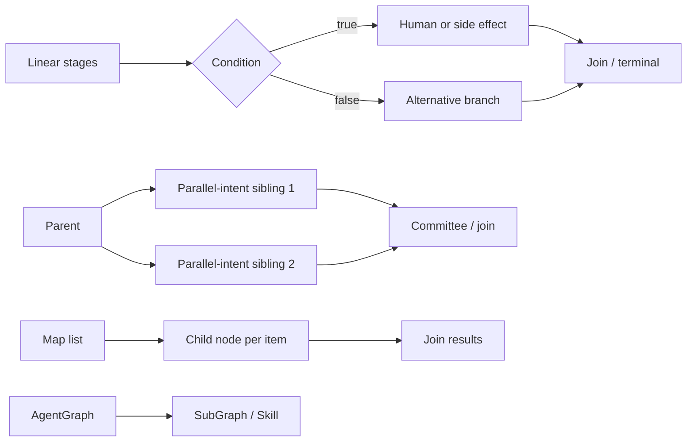

# AgentGraph Application Architecture

[System overview](overview.md) · [JobManager](engine/jobmanager.md) · [TaskManager](engine/taskmanager.md) · [Application index](../index.md#applications)

**Sandbox target (2026-11-14):** every AgentGraph will explicitly reference
`sandbox_id`; Sandbox resources/network rules move to the Controller-managed
pool. The [fixed-pool design](engine/sandbox.md) supersedes inline Sandbox
policy/resource ownership below. Examples below still describe the current
decoder, which does not accept `sandbox_id` until implementation migrates.

**Layer:** L2 application orchestration above the L1 engine components

**Runtime placement:** one required `runtime_mode` (`application` or `session`)

AgentGraph is the application-facing DAG model. It defines which work is
deterministic, which work may use an LLM, how outputs move between nodes, where
approval is required, and which side effects are permitted. The L1 engine
persists, schedules, dispatches, isolates, and observes the configured graph.
Concrete application nodes, edges, integrations, and E2E evidence belong to
the owning `use-cases/{use-case}/README.md`, linked from the use-case catalog.

```text
AgentGraph manifest + Agent/MCP/Skill definitions
                    │
                    ▼
          API Server validates/imports
                    │
                    ▼
       JobManager resolves DAG readiness
                    │ ExecutionPlan
                    ▼
       TaskManager executor router
          │       │         │
          │       │         └──► Sandbox worker
          │       └────────────► Remote MCP / external system
          └────────────────────► LLM provider
                    │
                    ▼
       state, approvals, results, notifications
```

| Part | Purpose |
|---|---|
| [DAG model and patterns](#manifest-and-dag-model) | Canonical manifest, data graph, composition, and 12 node types |
| [Limits and practices](#flexibility-and-current-limits) | Current execution boundaries and safe authoring rules |
| [Application resources](#execution-context-and-cross-run-knowledge) | Execution context, Knowledge, skills, agents, static manifests, and console lifecycle |

## Manifest and DAG Model

The current use cases use the console resource envelope:

```yaml
consoleVersion: core.flowgent.io/v1
kind: AgentGraph
metadata:
  name: example-graph
  namespace: default
  status: active
data:
  id: example-graph
  runtime_mode: application
  resources:
    jobmanager: { cpu: "500m", memory: "512Mi" }
    taskmanager: { cpu: "2", memory: "2Gi" }
    sandbox: { cpu: "2", memory: "2Gi" }
  vars: {}
  triggers: []
  nodes: []
  edges: []
```

The importer accepts exactly this envelope version and `data` payload. Every DAG
node is one flat object with a required `kind`; node parameters use `args`.
Unknown envelope and API request fields are rejected.

| AgentGraph field | Purpose | Flexibility / boundary |
|---|---|---|
| `id`, `namespace`, `labels` | Identity and ownership | IDs must be stable because revisions, Runs, topics, scopes, and runtime names depend on them |
| `vars` | Defaults available as `${vars.name}` | Run variables override defaults; secrets should enter through runtime Secrets, not manifests |
| `nodes` | Typed units of execution | Node IDs are unique within a graph and execute at most once in the current run state model |
| `edges` | `from`/`to` dependencies | Optional edge `condition` is boolean only and matches a condition node result |
| `triggers` | Schedule or webhook registration | REST and A2A can also create runs outside manifest trigger declarations |
| `input_schema`, `output_schema` | Discovery and validation contracts | Optional; node-level `output_schema` is strongly recommended for LLM output |
| `sandbox_policy` | AgentGraph-level sandbox defaults | A node may narrow or override policy within the configured security boundary |
| `runtime_mode` | Flink-style runtime lifecycle | Required; `application` creates a per-run runtime cluster, `session` uses the Helm-deployed shared runtime |
| `resources` | Application-mode pod-size overrides | Optional; may set `jobmanager`, `taskmanager`, and `sandbox` CPU/memory only. Replicas and slots remain platform defaults |

Inputs are resolved recursively immediately before execution. Exact references
such as `${node.field}` preserve arrays and objects as typed values; embedded
references are string interpolation. A node may reference any previously
completed node output, although depending only on declared ancestors keeps the
graph auditable.

## Supported Composition Patterns



| Pattern | Configuration | Current behavior |
|---|---|---|
| Linear pipeline | One outgoing edge per stage | Fully supported |
| Fan-out / fan-in | Sibling nodes plus committee or join | Ready siblings dispatch with a bounded concurrency cap; dynamic `map` child dispatch remains separate work |
| Boolean branch | `condition` node plus true/false edges | Supported; non-matching direct children are skipped |
| Human gate | `human.approval` with timeout/action | Creates a durable approval request, but JobManager pause/wait/resume is not yet wired |
| Bounded node retry | `retry.max/initial/max_delay/factor` | JobManager-owned; each attempt is a distinct, parent-linked NodeRun and OTel attempt span |
| Map and join | `map.source`, child node, concurrency, then `join` | `join` can merge supplied results; `map` currently returns a dispatch marker and does not schedule children |
| Nested graph | `subgraph` node | JobMaster executes static/adaptive children in the same GraphRun; TM handoff is nonterminal |
| Skill | `skill` node | Registered, but SkillExecutor is a stub and does not execute a runtime Skill |
| Isolated script | `sandbox` runtime/script/policy | Executed by independent Sandbox workers |
| Feedback loop | Conditional back-edge | Representable in YAML, but an already completed node is not reset; repeated-node loop semantics are not currently implemented |

## Supported Node Types

| Type | Executor | Use and configuration boundary |
|---|---|---|
| `agent` | AgentExecutor | LLM reasoning with agent, instruction, args, and optional JSON output schema |
| `tool` | ToolExecutor | Explicit remote MCP invocation selected by the DAG; HTTP Streamable transport only |
| `condition` | ConditionExecutor | Deterministic boolean expression used by true/false edges |
| `supervisor` | SupervisorExecutor | Produces/validates an allowed JSON action; Adaptive SubGraph decisions submit GraphPatch with revision CAS; unrestricted parent changes are rejected |
| `committee` | CommitteeExecutor | Deterministic majority decision over already-produced votes |
| `human` | HumanExecutor | Persists an approval request and returns `WAITING_HUMAN`; DAG suspension/resume is incomplete |
| `map` | MapExecutor | Stub marker; child fan-out runner is not connected to JobManager/TaskManager |
| `join` | JoinExecutor | Merge map or fan-out results |
| `subgraph` | SubGraphExecutor | JobMaster orchestrates pinned children; executor handoff returns WAITING |
| `skill` | SkillExecutor | Stub marker; runtime Skill execution is not implemented |
| `sandbox` | SandboxExecutor | Bash, Python, or Node script with resource/workspace/network policy |
| `noop` | NoopExecutor | Terminal or pass-through node |

Only `agent` and `supervisor` intentionally use an LLM. Tool selection,
branching, voting, approval, fan-out, joining, script dispatch, and terminal
behavior remain explicit in the graph.

## Flexibility and Current Limits

| Area | Flexible configuration | Current limit |
|---|---|---|
| Runtime topology | Same graph model across standalone and distributed execution | Distributed AgentGraphs choose `application` per-run isolation or `session` shared runtime |
| Scheduling | Dependencies, conditional branches, retries | JobManager blocks on each `Schedule()`; ready siblings are sequential and dynamic map fan-out is not connected |
| Cycles | Back-edges can be parsed | Node state is one-shot; back-edges do not rerun a completed node |
| Conditions | True/false edges from a condition result | Edge conditions are booleans, not arbitrary expressions; put expressions in the condition node |
| Failure | Node failure, timeout, retry, checkpoint state | A malformed graph with no ready node can leave pending work; validate reachability and acyclicity |
| MCP tools | Any independently deployed Streamable HTTP MCP service | No stdio subprocess MCP transport inside TaskManager |
| LLM output | Per-agent/model controls and per-node JSON schema | Unstructured output weakens interpolation, voting, and auditability |
| Execution context | NodeRun messages/tool state/checkpoints remain within one Run | Snapshot enforcement and durable checkpoint re-dispatch are not yet complete; see [data lifecycle](data-lifecycle.md) |
| Cross-run Knowledge | Namespace/AgentGraph/Run-scoped published revisions | Publication requires approval; no implicit inheritance of failed execution sessions |
| Sandbox | Runtime, timeout, resources, workspace, allow/deny network policy | Requires supported Linux/Kubernetes isolation features; allowlists must include actual proxy endpoints |
| Dynamic control | Supervisor returns schema-checked, allowlisted action JSON | Adaptive Supervisor commits scoped GraphPatch decisions; unrestricted parent changes are rejected |

## Best Practices

1. Keep side effects in explicit `tool` or `sandbox` nodes; agents should
   analyze or generate structured decisions, not hide network or Git mutations.
2. Put `output_schema` on every agent whose result drives interpolation,
   conditions, committee votes, commits, or reports.
3. Model independent reviews as static sibling nodes, then converge through a
   deterministic `committee` or `join`. Treat them as logically parallel but
   physically sequential; do not rely on dynamic `map` child execution yet.
4. Use the implemented approval API/publication workflow before irreversible
   side effects. Do not rely on a `human` DAG node to pause/resume a Run yet.
5. Make side-effect nodes idempotent: query existing state before creating a
   branch, pull request, ticket, or deployment.
6. Use node retry for bounded polling. Do not rely on a back-edge to rerun an
   already completed node until explicit loop/reset semantics exist.
7. Pass large artifacts through the shared workspace and bounded references;
   avoid copying full source trees or scan payloads through every NodeRun row.
8. Keep sandbox network policy concrete and minimal. Include the actual proxy
   host/port when a script connects through a proxy.
9. Use stable node IDs. They are part of NodeRun identity, output references,
   traces, and workspace paths.
10. End every branch deliberately through a join or terminal node, and validate
    that no branch can leave permanently pending nodes.

## Application Invariants

| Constraint | Rationale |
|-----------|-----------|
| Only `agent` and `supervisor` use LLM | All other nodes must be deterministic |
| Vote must be deterministic | LLM "judges", vote "decides" |
| Agent output must be JSON | Machine-readable, auditable |
| Supervisor output constrained | Allowed action JSON is validated; applying graph mutations remains open work |
| Human request is durable | Approval persistence exists; DAG pause/resume remains open work |
| Map nesting is a target | Multi-level dynamic fan-out remains open work |

---


## Execution Context and Cross-Run Knowledge

Flowgent does not implement an append-only `(agent_graph_id,node_instance_id)` memory table.
Execution context and reusable knowledge are intentionally separate:

- A NodeRun attempt owns its messages, tool state, execution memory, workspace
  version, and checkpoints. Redelivery of the same physical attempt can resume
  that attempt; a new Run does not inherit the prior session.
- Reusable facts and experience are immutable Knowledge Document revisions with
  Namespace/AgentGraph/Run scope, provenance, ACL checks, full-text/vector indexes,
  and approval-gated publication.
- Behavior belongs to immutable Instruction/Agent revisions rather than a
  generic memory blob.

The Run captures a context snapshot at creation, but runtime enforcement of
every captured Agent/Knowledge revision and all checkpoint re-dispatch paths is
still incomplete. The authoritative lifecycle and known gaps are documented in
[Durable data lifecycle](data-lifecycle.md).

---


## Runtime Skills and Portable Skill Definitions

### Core Insight

Flowgent has two deliberately separate Skill resources:

- A **runtime Skill** is a `kind: skill` AgentGraph DAG invoked by a `skill` node. It
  remains explicit orchestration and does not introduce an unrestricted ReAct
  loop.
- A **portable Skill definition** is a reusable instruction package backed by
  stable identity, immutable revisions, and allowlisted `assets/` and
  `scripts/` files. It is managed through `/skill-definitions` and is not a DAG.

Migrating an existing skill therefore means choosing whether it is executable
orchestration (runtime Skill) or reusable instruction/files (portable Skill
definition); the two MUST NOT be silently conflated.

### AgentGraphSpec — Optional Fields for Skills

```go
type AgentGraphSpec struct {
    ID           string         `json:"id" yaml:"id"`
    Kind         string         `json:"kind,omitempty" yaml:"kind,omitempty"`           // "skill" | "" (empty = regular graph)
    Description  string         `json:"description,omitempty" yaml:"description,omitempty"`
    Summary      string         `json:"summary,omitempty" yaml:"summary,omitempty"`     // one-liner for A2A card
    InputSchema  *JSONSchema    `json:"input_schema,omitempty" yaml:"input_schema,omitempty"`
    OutputSchema *JSONSchema    `json:"output_schema,omitempty" yaml:"output_schema,omitempty"`
    Vars         map[string]any `json:"vars,omitempty" yaml:"vars,omitempty"`
    Nodes        []Node         `json:"nodes" yaml:"nodes"`
    Edges        []Edge         `json:"edges" yaml:"edges"`
    Triggers     []TriggerDef   `json:"triggers,omitempty" yaml:"triggers,omitempty"`
}
```

`input_schema` and `output_schema` are entirely optional. Schemas are purely for A2A discovery and optional validation.

### Canonical Skill AgentGraph

```yaml
# etc/skills/01-dependency-scan.yaml
consoleVersion: core.flowgent.io/v1
kind: AgentGraph
metadata:
  name: dependency-scan
data:
  id: dependency-scan
  kind: skill
  summary: "Scan project dependencies for known CVEs"
  nodes:
    - id: clone
      kind: tool
      tool: github
      args:
        action: clone_repo
        url: ${vars.repo_url}
    - id: scan
      kind: tool
      tool: dependency-checker
      args:
        path: ${clone.output.path}
    - id: normalize
      kind: agent
      agent: issue-detector
      args:
        raw_output: ${scan.output}
  edges:
    - { from: clone, to: scan }
    - { from: scan, to: normalize }
```

Reference from any graph: `kind: agentgraph`, `agentgraph: dependency-scan`.

## Agent Definitions

### Tools Belong to the DAG, Not the Agent

Tools are deterministic DAG nodes (`kind: tool`). The graph designer decides which tool to call, at which step, with which inputs. The agent receives tool output and reasons about it — it never decides to call a tool itself. This is the architectural line between enterprise orchestration (DAG-controlled) and personal AI assistants (ReAct loop).

### AgentDef — Structured Additions

```go
type AgentDef struct {
    Name         string      `json:"name" yaml:"name"`
    Model        string      `json:"model" yaml:"model"`
    Soul         string      `json:"soul" yaml:"soul"`
    Instruction  string      `json:"instruction" yaml:"instruction"`
    OutputSchema *JSONSchema `json:"output_schema,omitempty" yaml:"output_schema,omitempty"`
    Temperature  *float64    `json:"temperature,omitempty" yaml:"temperature,omitempty"`
    MaxTokens    int         `json:"max_tokens,omitempty" yaml:"max_tokens,omitempty"`
}
```

| Field | Why |
|-------|-----|
| `output_schema` | Structured output contract — replaces prose "Output STRICT JSON: {...}" in `instruction`. Enables validation. |
| `temperature` | Per-agent override. Supervisor needs 0.2; creative reviewer may want 0.5. |
| `max_tokens` | Output length control per agent role. |

---


## Directory-Based Configuration

### Config Layout

```yaml
orchestration:
  mcps: [...]
  agents:
    static:  { enabled: true, load-dir: "agents/",  refresh: 30s }
    standard: { enabled: false }   # DB-backed (future UI)
  skills:
    static:  { enabled: true, load-dir: "skills/",  refresh: 30s }
    standard: { enabled: false }
  agentgraphs:
    static:  { enabled: true, load-dir: "graphs/",   refresh: 1m }
    standard: { enabled: false }
```

### Directory Layout

Project use cases keep executable resources together while the root `etc/`
directory holds the annotated engine configuration:

```tree
etc/
└── flowgent.yaml

use-cases/{use-case}/config/
├── agents/                  # Agent definitions
├── graphs/                   # AgentGraph manifests
├── mcps/                    # Remote MCP definitions
├── skills/                  # Skill manifests and resources
├── llmproviders/            # Model/provider definitions when needed
└── notifiers/               # Delivery-channel definitions when needed
```

Numeric filename prefixes are optional and are useful when human-readable load
order matters. The loader processes YAML files alphabetically; semantic DAG
order comes from edges, never filenames.

### Static Manifest Loader

```go
func loadResourceDir[T any](dir string) ([]T, error) {
    entries, _ := os.ReadDir(dir)
    var result []T
    for _, e := range entries {
        if e.IsDir() || filepath.Ext(e.Name()) != ".yaml" { continue }
        data, _ := os.ReadFile(filepath.Join(dir, e.Name()))
        var item T
        yaml.Unmarshal(data, &item)
        result = append(result, item)
    }
    return result, nil
}
```

---


## Flowgent Console and Resource Lifecycle

The `flowgent console` is the offline resource management tool for Flowgent.
It provides import/export and CRUD for all resource kinds, enabling seamless
migration between environments (dev → staging → production) and backup/restore
workflows.

### Architecture

```
┌──────────────────────────────────────────────────────────────────┐
│                    Flowgent Console (REPL)                        │
│                                                                   │
│  ┌──────────┐  ┌──────────┐  ┌──────────┐  ┌──────────────────┐ │
│  │  Export   │  │  Import  │  │   CRUD   │  │   Lazy Stores    │ │
│  │  Engine   │  │  Engine  │  │  (list/  │  │   (agents, graphs, │ │
│  │  (YAML/   │  │  (YAML/  │  │   get/   │  │    runs, channels,│ │
│  │   JSON)   │  │   JSON)  │  │   add/   │  │    llm, mcps)     │ │
│  │           │  │          │  │  remove) │  │                   │ │
│  └─────┬─────┘  └────┬─────┘  └────┬─────┘  └────────┬──────────┘ │
│        │              │             │                  │            │
│        └──────────────┴─────────────┴──────────────────┘            │
│                              │                                     │
│                     FlowgentConsole                                │
│                    (lazy store init)                               │
│                              │                                     │
│                     ┌────────┴────────┐                            │
│                     │  IStorage (DB)  │                            │
│                     │  PG / SQLite    │                            │
│                     └─────────────────┘                            │
└──────────────────────────────────────────────────────────────────┘
```

### Supported Resource Kinds

| Kind | CLI Name | REST Endpoint | Export | Import | CRUD (list/get/add/remove) |
|------|----------|---------------|--------|--------|---------------------------|
| Agent | `agent` | `/api/v1/{namespace}/agents` | yes | yes | yes |
| MCP | `mcp` | `/api/v1/{namespace}/mcp` | yes | yes | yes |
| LLMProvider | `llm` | `/api/v1/{namespace}/llm/providers` | yes | yes | yes |
| NotifyChannel | `channel` | `/api/v1/{namespace}/notifications/channels` | yes | yes | yes |
| Runtime Skill (AgentGraph with kind=skill) | `skill` | `/api/v1/{namespace}/skills` | yes | yes | yes |
| Portable Skill definition | — | `/api/v1/{namespace}/skill-definitions` | no | no | API/UI CRUD + file upload |
| AgentGraph | `graph` | `/api/v1/{namespace}/agent-graphs` | yes | yes | yes |
| GraphRun | `graphrun` | `/api/v1/{namespace}/graph-runs` | yes | yes | yes |

### Import/Export Design

**Golden rule**: Export → Import must be seamless and lossless. Resources
exported from one Flowgent instance must re-import cleanly into another,
regardless of backend (PG → SQLite or vice versa).

AgentVault private keys are not Flowgent resources and cannot appear in
Flowgent import/export data.

**Output format** is auto-detected from file extension:
`.json` → JSON (indented), `.yaml`/`.yml` → YAML.

### CLI Usage

```bash
# Interactive REPL
flowgent console -c etc/flowgent.yaml

# Batch export — all supported Flowgent resource kinds
flowgent console -c etc/flowgent.yaml -- export --output /tmp/backup.yaml

# Batch export — filtered by kind
flowgent console -c etc/flowgent.yaml -- export \
  --kind mcp,llm,agent,graph,graphrun,skill,channel \
  --output /tmp/flowgent_data.json

# Import from files/directories (supports glob patterns)
flowgent console -c etc/flowgent.yaml -- import config/agents/*.yaml
flowgent console -c etc/flowgent.yaml -- import config/mcps/
flowgent console -c etc/flowgent.yaml -- import /tmp/backup.yaml
```

### Import File Format — K8s-Style Single Resource

Each YAML/JSON file uses a Kubernetes-style resource wrapper. The importer
accepts `apiVersion` or `consoleVersion`, and accepts `spec` or `data` as the
resource payload. Current use cases use `consoleVersion` + `data`; the following
`apiVersion` + `spec` form remains supported:

```yaml
apiVersion: console.flowgent.io/v1
kind: MCP
metadata:
  name: example-service
  namespace: default
  labels:
    catalog: example
  status: active
  description: Example Streamable HTTP MCP service
spec:
  enabled: true
  transport: http
  rpc_url: https://mcp.example.com/mcp
```

Valid `kind` values: `Agent`, `MCP`, `LLMProvider`, `AgentGraph`, `GraphRun`, `Skill`,
`NotifyChannel`. The `spec` or `data` block is the raw entity payload —
identical to what the REST API accepts.

### Import File Format — Bulk ExportData

For full backups, the export produces a single file containing all resources in
a top-level container:

```yaml
llms:
  - name: deepseek
    type: openai
    base_uri: https://api.deepseek.com
    default_model: deepseek-chat
    ...
mcps:
  - name: example-service
    enabled: true
    transport: http
    rpc_url: https://mcp.example.com/mcp
    ...
agents:
  - name: supervisor
    model: deepseek/deepseek-chat
    soul: ...
    ...
agentAgentGraphs:
  - id: example-graph
    kind: graph
    nodes: [...]
    edges: [...]
skills:
  - id: example-skill
    kind: skill
    nodes: [...]
    edges: [...]
graphRuns:
  - id: run-abc123
    agent_graph_id: 019...
    agent_graph_name: example-graph
    input: {}
    status: COMPLETED
    ...
channels:
  - id: slack-alerts
    type: slack
    ...
```

This format supports seamless re-import: `ImportAll()` iterates each section
and writes to the corresponding store.

### E2E Migration Workflow

```bash
# 1. Export from production
flowgent console -c etc/prod.yaml -- export --output /tmp/prod-export.yaml

# 2. Import to staging (validates the exported file)
flowgent console -c etc/staging.yaml -- import /tmp/prod-export.yaml

# 3. Or — import individual resource files from a config directory
flowgent console -c etc/dev.yaml -- import \
  use-cases/my-application/config/agents/ \
  use-cases/my-application/config/agent-graphs/ \
  use-cases/my-application/config/mcps/ \
  use-cases/my-application/config/skills/
```

### Module Dependency

`console` depends on `config` (FlowgentConfig), `model` (entities), and `storage`
(database access). It sits at
the same level as `core` in the dependency graph — both are mid-tier modules
that `cmd` orchestrates. See the
[shared module map](overview.md#code-layout-and-shared-module-map).

```
config + model + store
         ↑
       console
         ↑
        cmd (→ everything, including console)
```

## Expected Behavior

1. **Given** a valid graph manifest, **when** it is imported, **then** node IDs,
   edges, variables, schemas, and runtime policies MUST survive persistence and
   retrieval without semantic change.
2. **Given** a node whose dependencies are incomplete, **when** JobManager
   evaluates readiness, **then** that node MUST NOT be dispatched.
3. **Given** a condition result, **when** outgoing boolean edges are evaluated,
   **then** matching children MUST remain eligible and non-matching children
   MUST become `SKIPPED` deterministically.
4. **Given** an agent result used by another node, **when** execution succeeds,
   **then** its declared `output_schema` MUST be satisfied before downstream
   interpolation or voting relies on it.
5. **Given** a side effect such as a commit, PR, or notification, **when** the
   graph reaches it, **then** the effect MUST occur in an explicit tool or
   sandbox node after all configured deterministic and human gates.
6. **Target contract (not current runtime behavior): Given** a supervisor node,
   **when** it proposes control changes, **then** only configured actions within
   retry, node, and injection quotas may apply. Today the action is validated
   but JobManager does not apply the graph mutation.
7. **Given** a back-edge to an already completed node, **when** the current
   runtime evaluates the graph, **then** the node MUST NOT be represented as a
   newly executed iteration. Authors may use node retry today; nested subgraph
   execution is a target capability and is not yet implemented.

## AgentGraph domain and durable recovery

The domain vocabulary is normative across Go, REST, MQTT, SQL, manifests, Web,
and E2E. This is a breaking cleanup; old domain aliases and REST route aliases
are removed. Existing databases MUST NOT be reused without rebuilding or an
explicit data migration. Startup never deletes an existing database.

| Term | Meaning |
|---|---|
| AgentGraph | Published definition composed of GraphNodes and directed dependencies |
| AgentGraphRevision | Immutable published definition, including its checksum |
| GraphNode | One definition used by dispatch and snapshots; authoring and dispatch use the same definition |
| GraphRun | One execution with a closed AgentGraph snapshot, typed SubGraphs, NodeRuns and state/event progress |
| NodeRun | One Attempt with its own ID, accepted context, input/output, error, execution identity and workspace reference |
| SubGraph | Scoped static/adaptive child execution with its own GraphRevision |
| GraphPatch | Content-bound, idempotent changes committed against an expected SubGraph revision |
| GraphRevision | Runtime topology revision of one mutable SubGraph; distinct from AgentGraphRevision |

A GraphRun copies the complete nested definition tree when created. Referenced
SubGraph definitions and agent personas are pinned in the creation transaction.
Changing a published graph or agent afterward cannot change an in-flight run.
The database protects GraphRun identity and snapshot columns from updates.
The Web run view renders the execution snapshot, rather than the latest
published graph. A NodeRun's `node_instance_id` remains stable across Attempts;
its `id` changes on retry. `ExecutionPlan` remains a private JM→TM DTO.

Canonical resources are `/agent-graphs`, `/graph-runs`, and
`/graph-runs/{graph_run_id}/node-runs`, below `/api/v1/{namespace}`. Nested Run
route aliases are removed. Authoring uses `kind: subgraph` and
`subgraph: {ref, mode}`; an omitted mode is static. Public fields include
`agent_graph_id`, `agent_graph_name`, `graph_run_id`, `graph_node_id`,
`node_instance_id`, `node_run_id`, and `subgraph_instance_id`. IDs and names
are separate. A watch response has a `cursor`, not a definition revision.
The REST schemas and internal actions are specified by the embedded OpenAPI.
TaskManager/JobManager/Sandbox are physical component names. A2A Task and
ReactFlow names belong to their external protocols/libraries.

### Step commit, Outbox and checkpoint

The runtime MUST commit accepted business state before notifying another
component. GraphRun creation, NodeRun state, accepted LLM context, GraphPatch,
and result records use API-owned transactions. Node state events, graph
progress and the corresponding Outbox share the transaction. JM/TM/Sandbox
never open a business database connection. Sandbox handoff is also committed
through the API; Sandbox commits its verified result before sending MQTT.
Credentials are resolved at the Sandbox worker, and are not stored in its
handoff Outbox payload.

This is a step commit/event ledger. A GraphCheckpoint is a separate consistent
cut: snapshot, SubGraph revisions, NodeRuns, state version, event cursor,
artifact/workspace references and digest. The API takes the same GraphRun lock
as state writers while reading the cut, then appends one immutable checkpoint
event. No Flink network barrier or second execution state machine is used.

JobMaster requests a full checkpoint every 20 finished nodes or 30 seconds, and
at successful completion. It does not serialize the entire run for each token
or notification. Progress tokens, logs and telemetry can remain ephemeral;
accepted decisions, tool boundaries, waits and outcomes MUST be durable.
Input/output and large checkpoint/context JSON reuse the checksummed Artifact
Provider. Inline accepted messages also use the existing append-only message
ledger. Small state changes and Outbox are committed together to avoid an extra
synchronous database round trip for publication.

Recovery verifies the latest checkpoint digest and graph identity, falling back
to an earlier valid checkpoint when needed. It overlays current committed
NodeRuns instead of rolling the ledger back. Completed Attempts never run
again; pending work retains its logical identity; late/superseded results cannot
advance state. An unresolved live operation is held for reconciliation. A
checkpoint alone does not make an external action safe to repeat. Source replay,
external idempotency and ExternalEffect reconciliation remain necessary.

### Workspace recovery

Sandbox uses the existing durable workspace/PVC. Before code execution it
captures an immutable baseline, then commits the NodeCheckpoint through API.
After execution it stops remaining processes in the execution process group,
captures and verifies the resulting workspace, and atomically publishes the
result file. A successful NodeRun cannot be committed without that reference.

Snapshot manifests contain relative paths, modes, lengths, content hashes and
the Git base commit. Files are fsynced; completed manifests are published by
atomic directory rename. Content-addressed objects share unchanged files by
hard link, avoiding repeated full-checkout copies. The default capture limit is
512 MiB. A failed capture does not produce a valid reference. Partial staging
directories are not checkpoints.

A retry carries the committed baseline and original owned script path. Sandbox
holds a cross-process workspace lock, validates the manifest and files, restores
into a staging directory, verifies the Git base, then replaces the owned
workspace. It never restores over a live writer or from a corrupt reference.
An already completed, redelivered handoff republishes its saved result rather
than restoring and executing again. Workspace rollback does not undo external
effects. PVC loss requires recovering the PVC or using an artifact-backed
workspace backend; context Artifact Providers do not automatically back up a PVC.

### Models, checks and remaining scope

Persistence reuses `orh_agent_graph`, `orh_agent_graph_revision`,
`orh_graph_run`, `orh_node_run`, `orh_node_checkpoint`, `orh_node_message`,
`orh_dispatch`, `orh_event` and `orh_outbox`. `orh_graph_run.snapshot` stores the
closed definition; a GraphCheckpoint is an immutable event, not another task
ledger or scheduler. API recovery respects both GraphRun and NodeRun scopes.

The security fixer verifiers cover static/adaptive SubGraphs and CAS (61),
claims/result Outbox/late Attempts (62), and SIGKILL during workspace mutation,
baseline restoration, retry and checkpoint recovery (63). Unit/integration
checks additionally cover manifest corruption, incomplete capture, immutable
snapshots, checkpoint transaction rollback and fallback to an older checkpoint.
These checks do not establish automatic recovery from simultaneous Kubernetes
JM/TM/EMQX failure. Cooperative live safepoints, automatic reconciliation of
unknown external effects, complete cumulative budget inheritance, SourceEvent /
WorkItem / Watchdog and named policy/Schema resolution remain separate work.
Named policy/Schema references fail closed until a resolver is installed.
