# AgentGraph 应用架构

[English](agent-graph.md) · [系统总览](overview_ZH.md) · [JobManager](engine/jobmanager_ZH.md) · [TaskManager](engine/taskmanager_ZH.md) · [应用索引](../index_ZH.md#应用)

**Sandbox 目标（2026-11-14）：** 每个 AgentGraph 将显式引用 `sandbox_id`，
Sandbox 资源/网络规则归 Controller 管理的固定池。[固定池设计](engine/sandbox_ZH.md)
替代下文内联 Sandbox Policy/Resource 归属。下文示例仍对应当前解码器，
代码迁移前不接受 `sandbox_id` 字段。

**层级：** L1 引擎组件之上的 L2 应用编排

**运行时绑定：** 每个 AgentGraph 必须声明一个 `runtime_mode`（`application` 或 `session`）

AgentGraph 是面向应用的 DAG 模型：它定义哪些工作是确定性的、哪些可使用 LLM、输出如何在节点间流动、何处需要审批，以及允许哪些副作用。L1 引擎负责持久化、调度、分派、隔离和观测这张图。具体应用的 Nodes、Edges、Integrations 与 E2E 证据归属 `use-cases/{use-case}/README.md`，并由文档索引统一索引。

```text
AgentGraph manifest + Agent/MCP/Skill definitions
                    │
                    ▼
          API Server 校验并导入
                    │
                    ▼
       JobManager 判断 DAG readiness
                    │ ExecutionPlan
                    ▼
       TaskManager executor router
          │       │         │
          │       │         └──► Sandbox worker
          │       └────────────► Remote MCP / external system
          └────────────────────► LLM provider
                    │
                    ▼
       状态、审批、结果与通知
```

| 部分 | 目的 |
|---|---|
| [Manifest 与 DAG](#manifest-与-dag-模型) | 规范 Manifest、数据流、组合方式与 12 种节点 |
| [灵活性与限制](#灵活性与当前限制) | 当前执行边界与安全编写规则 |
| [应用资源](#执行上下文与跨-run-knowledge) | Execution Context、Knowledge、Skill、Agent、静态 Manifest 与 Console 生命周期 |

## Manifest 与 DAG 模型

当前用例使用 console resource envelope：

```yaml
consoleVersion: core.flowgent.io/v1
kind: AgentGraph
metadata:
  name: example-graph
  namespace: default
  status: active
data:
  id: example-graph
  runtime_mode: application
  resources:
    jobmanager: { cpu: "500m", memory: "512Mi" }
    taskmanager: { cpu: "2", memory: "2Gi" }
    sandbox: { cpu: "2", memory: "2Gi" }
  vars: {}
  triggers: []
  nodes: []
  edges: []
```

Importer 仅接受这一 envelope 版本与 `data` 载荷。每个 DAG 节点都是一个
扁平对象，必须声明 `kind`，节点参数统一使用 `args`。未知 envelope 与 API
请求字段会被拒绝。

| AgentGraph 字段 | 目的 | 灵活性与边界 |
|---|---|---|
| `id`, `namespace`, `labels` | 身份与所有权 | ID MUST 稳定；Revision、Run、Topic、Scope 与运行时名称均依赖它 |
| `vars` | `${vars.name}` 可见的默认值 | run 变量覆盖默认值；secret MUST 经运行时 Secret 注入，不写入 manifest |
| `nodes` | 有类型的执行单元 | ID 在流程内唯一；当前 run 状态模型中每节点至多执行一次 |
| `edges` | `from`/`to` 依赖 | 可选 `condition` 仅为 boolean，并匹配 condition 节点结果 |
| `triggers` | schedule/webhook 注册 | REST 与 A2A 也可在 manifest trigger 之外创建 run |
| `input_schema`, `output_schema` | 发现与校验契约 | 可选；强烈建议 LLM 节点声明 `output_schema` |
| `sandbox_policy` | 流程级沙箱默认策略 | 节点可在既定安全边界内收紧或覆盖 |
| `runtime_mode` | Flink 风格运行时生命周期 | 必填；`application` 创建每 Run runtime cluster，`session` 使用 Helm 部署的共享 runtime |
| `resources` | Application 模式 Pod size 覆盖 | 可选；只能设置 `jobmanager`、`taskmanager` 和 `sandbox` 的 CPU/Memory。副本数和 slot 由平台默认值控制 |

输入在执行前递归解析。`${node.field}` 这类完整引用保留数组和对象的类型；嵌入其他字符串的引用执行字符串插值。节点可引用任一已完成节点输出，但只依赖声明的祖先节点可令图保持可审计。

## 支持的组合模式

```mermaid
flowchart LR
    A[线性阶段] --> B{Condition}
    B -->|true| C[人工审批或副作用]
    B -->|false| D[备选分支]
    C --> E[Join / terminal]
    D --> E

    F[Parent] --> G1[并行意图 sibling 1]
    F --> G2[并行意图 sibling 2]
    G1 --> H[Committee / join]
    G2 --> H

    I[Map list] --> J[每项一个 child node]
    J --> K[Join results]

    L[AgentGraph] --> M[SubGraph / Skill]
```



| 模式 | 配置 | 当前行为 |
|---|---|---|
| 线性流水线 | 每阶段一条出边 | 完整支持 |
| Fan-out / fan-in | sibling 节点后接 committee 或 join | Ready sibling 按有界并发派发；动态 `map` Child 是独立工作 |
| Boolean 分支 | `condition` 节点及 true/false edges | 支持；不匹配的直接子节点被跳过 |
| 人工门禁 | 带 timeout/action 的 `human.approval` | 创建持久审批请求，但 JobManager Pause/Wait/Resume 尚未接入 |
| 有界节点重试 | `retry.max/initial/max_delay/factor` | 由 JobManager 管理；每次 attempt 是独立、Parent 关联的 NodeRun 与 OTel attempt Span |
| Map 与 join | `map.source`、child node、concurrency 后接 `join` | `join` 可合并已提供结果；`map` 当前只返回 Dispatch Marker，不会调度 Child |
| 嵌套流程 | `subgraph` 节点 | JobMaster 在同一 GraphRun 中执行 static/adaptive 子图；TM 交接保持非终态 |
| Skill | `skill` 节点 | 已注册，但 SkillExecutor 是 Stub，不会执行 Runtime Skill |
| 隔离脚本 | `sandbox` runtime/script/policy | 在独立 Sandbox worker 执行 |
| 反馈环 | 条件 back-edge | YAML 可表达，但 completed 节点不会 reset；尚未实现同一节点重复循环执行 |

## 支持的节点类型

| 类型 | Executor | 用途与配置边界 |
|---|---|---|
| `agent` | AgentExecutor | LLM 推理，包含 agent、instruction、args 与可选 JSON schema |
| `tool` | ToolExecutor | DAG 显式选择的远程 MCP 调用；只支持 HTTP Streamable transport |
| `condition` | ConditionExecutor | 确定性 boolean 表达式，驱动 true/false edges |
| `supervisor` | SupervisorExecutor | 生成并校验 Allowlist JSON Action；Adaptive SubGraph 决策通过 GraphPatch CAS 提交，拒绝越界修改父图 |
| `committee` | CommitteeExecutor | 对既有 vote 做确定性多数决 |
| `human` | HumanExecutor | 持久化 Approval 并返回 `WAITING_HUMAN`；DAG 暂停/恢复未完成 |
| `map` | MapExecutor | Stub Marker；Child Fan-out Runner 尚未连接 JobManager/TaskManager |
| `join` | JoinExecutor | 合并 map 或 fan-out 结果 |
| `subgraph` | SubGraphExecutor | JobMaster 编排固定版本子图；执行器交接返回 WAITING |
| `skill` | SkillExecutor | Stub Marker；未实现 Runtime Skill 执行 |
| `sandbox` | SandboxExecutor | 带资源、工作区和网络策略的 Bash/Python/Node 脚本 |
| `noop` | NoopExecutor | terminal 或 pass-through |

只有 `agent` 与 `supervisor` 有意使用 LLM。工具选择、分支、投票、审批、fan-out、join、脚本分派和终止行为都显式存在于图中。

## 灵活性与当前限制

| 领域 | 可配置能力 | 当前限制 |
|---|---|---|
| 运行时拓扑 | standalone 与 distributed 使用同一 AgentGraph 模型 | 分布式 AgentGraph 选择 `application` 每 Run 隔离或 `session` 共享 runtime |
| 调度 | 依赖、条件分支与 retry | JobManager 对每个 `Schedule()` 阻塞；ready siblings 顺序执行，动态 Map Fan-out 未连接 |
| 循环 | 可解析 back-edge | 节点状态是 one-shot；back-edge 不会重跑 completed 节点 |
| 条件 | condition 结果的 true/false edges | edge condition 仅为 boolean；复杂表达式放入 condition 节点 |
| 失败 | 节点失败、超时、retry 与 checkpoint | 无 ready 节点的畸形图可能遗留 pending 工作；必须校验可达性与无环性 |
| MCP tools | 任意独立部署的 Streamable HTTP MCP 服务 | TaskManager 内不支持 stdio 子进程 transport |
| LLM 输出 | 每 agent/model 参数和每节点 JSON schema | 非结构化输出削弱插值、投票与审计 |
| Execution Context | NodeRun Message/Tool State/Checkpoint 只属于一个 Run | 快照版本强制与持久 Checkpoint 重派尚未完全实现；见[数据生命周期](data-lifecycle_ZH.md) |
| 跨 Run Knowledge | Namespace/AgentGraph/Run Scope 的已发布 Revision | 发布必须审批；失败执行会话不会隐式传给新 Run |
| Sandbox | runtime、timeout、resources、workspace、network allow/deny | 依赖 Linux/K8s 隔离能力；allowlist 必须包含实际 proxy endpoint |
| 动态控制 | Supervisor 返回 Schema 校验且 Allowlist 的 Action JSON | JobManager 尚未应用 Retry/Redirect/Inject/Abort；Supervisor 不是可工作的控制循环 |

## 最佳实践

1. 副作用放在显式 `tool` 或 `sandbox` 节点；agent 只分析或产生结构化决策，不隐藏网络或 Git 修改。
2. 任何被插值、condition、committee、commit 或 report 消费的 agent 结果都应声明 `output_schema`。
3. 独立 Review 使用静态 Sibling Node，再以确定性的 `committee` 或 `join` 汇合；当前
   只是逻辑并行、物理顺序执行，不得依赖动态 `map` Child 执行。
4. 不可逆副作用前使用已实现的 Approval API/Publication Workflow；当前不得依赖
   `human` DAG Node 暂停并恢复 Run。
5. 副作用节点必须幂等：创建 branch、PR、ticket 或 deployment 前先查询现有状态。
6. 有界轮询使用 node retry；在 loop/reset 语义实现前，MUST NOT 依赖 back-edge 重跑 completed 节点。
7. 大型产物经共享工作区与有界引用传递，避免在每条 NodeRun row 中复制完整源码树或扫描载荷。
8. Sandbox 网络策略应具体且最小；经 proxy 连接时必须包含真实 proxy host/port。
9. 节点 ID 必须稳定，因为它参与 NodeRun identity、output reference、trace 和 workspace path。
10. 每个分支必须明确到达 join 或 terminal，并校验不存在永久 pending 的路径。

## 应用不变量

| 约束 | 理由 |
|---|---|
| 只有 `agent` 和 `supervisor` 使用 LLM | 其他节点必须确定性执行 |
| Vote 必须确定 | LLM 负责判断，vote 负责决定 |
| Agent 输出必须为 JSON | 机器可读且可审计 |
| Supervisor Output 受限 | Allowlist Action JSON 已校验；应用图变更仍是开放工作 |
| Human Request 持久化 | Approval Persistence 已有；DAG Pause/Resume 仍是开放工作 |
| Map 嵌套是目标能力 | 多层动态 Fan-out 仍是开放工作 |

## 执行上下文与跨 Run Knowledge

Flowgent 不实现持续追加的 `(agent_graph_id,node_instance_id)` Memory 表。Execution Context 与可复用
Knowledge 有意分离：

- NodeRun attempt 拥有 Message、Tool State、Execution Memory、Workspace Version 与
  Checkpoint。同一物理 attempt 重投可继续该 attempt；新 Run 不继承旧会话。
- 可复用事实和经验以不可变 Knowledge Document Revision 保存，具有 Namespace/AgentGraph/Run
  Scope、Provenance、ACL、全文/向量索引和审批发布。
- 行为归属于不可变 Instruction/Agent Revision，而不是万能 Memory Blob。

创建 Run 时会捕获 Context Snapshot，但运行时对每个 Agent/Knowledge Revision 的强制使用
以及所有 Checkpoint 重派路径仍未完全实现。权威生命周期与已知缺口见
[持久数据生命周期](data-lifecycle_ZH.md)。

## 运行时 Skill 与便携式 Skill Definition

Flowgent 有两种有意分离的 Skill 资源：

- **运行时 Skill** 是由 `skill` 节点调用的 `kind: skill` AgentGraph DAG。它仍是显式编排，
  不引入无限制 ReAct Loop。
- **便携式 Skill Definition** 是可复用 Instruction Package，具有稳定身份、不可变
  Revision，以及白名单 `assets/`、`scripts/` 文件；通过 `/skill-definitions` 管理，
  本身不是 DAG。

迁移现有 Skill 时必须判断其属于可执行编排还是可复用指令/文件，二者 **MUST NOT**
被静默混为同一实体。

```go
type AgentGraphSpec struct {
    ID           string         `json:"id" yaml:"id"`
    Kind         string         `json:"kind,omitempty" yaml:"kind,omitempty"` // "skill" 或空
    Description  string         `json:"description,omitempty" yaml:"description,omitempty"`
    Summary      string         `json:"summary,omitempty" yaml:"summary,omitempty"`
    InputSchema  *JSONSchema    `json:"input_schema,omitempty" yaml:"input_schema,omitempty"`
    OutputSchema *JSONSchema    `json:"output_schema,omitempty" yaml:"output_schema,omitempty"`
    Vars         map[string]any `json:"vars,omitempty" yaml:"vars,omitempty"`
    Nodes        []Node         `json:"nodes" yaml:"nodes"`
    Edges        []Edge         `json:"edges" yaml:"edges"`
    Triggers     []TriggerDef   `json:"triggers,omitempty" yaml:"triggers,omitempty"`
}
```

`input_schema` 与 `output_schema` 完全可选，只用于 A2A 发现与可选校验。

```yaml
consoleVersion: core.flowgent.io/v1
kind: AgentGraph
metadata:
  name: dependency-scan
data:
  id: dependency-scan
  kind: skill
  summary: "Scan project dependencies for known CVEs"
  nodes:
    - id: clone
      kind: tool
      tool: github
      args: { action: clone_repo, url: "${vars.repo_url}" }
    - id: scan
      kind: tool
      tool: dependency-checker
      args: { path: "${clone.output.path}" }
    - id: normalize
      kind: agent
      agent: issue-detector
      args: { raw_output: "${scan.output}" }
  edges:
    - { from: clone, to: scan }
    - { from: scan, to: normalize }
```

任意流程可用 `kind: agentgraph`、`agentgraph: dependency-scan` 引用它。

## Agent 定义

工具属于 DAG，不属于 Agent。流程作者决定在何时以哪些输入调用哪个 `kind: tool`；agent 只消费工具输出并推理，不能自行决定调用工具。这是 DAG 控制的企业编排与 ReAct 型个人助手之间的架构边界。

```go
type AgentDef struct {
    Name         string      `json:"name" yaml:"name"`
    Model        string      `json:"model" yaml:"model"`
    Soul         string      `json:"soul" yaml:"soul"`
    Instruction  string      `json:"instruction" yaml:"instruction"`
    OutputSchema *JSONSchema `json:"output_schema,omitempty" yaml:"output_schema,omitempty"`
    Temperature  *float64    `json:"temperature,omitempty" yaml:"temperature,omitempty"`
    MaxTokens    int         `json:"max_tokens,omitempty" yaml:"max_tokens,omitempty"`
}
```

| 字段 | 目的 |
|---|---|
| `output_schema` | 结构化输出契约，替代 instruction 中的 prose JSON 约定并支持校验 |
| `temperature` | 每 agent 覆盖；如 supervisor 0.2、creative reviewer 0.5 |
| `max_tokens` | 按 agent role 控制输出长度 |

## 基于目录的配置

```yaml
orchestration:
  mcps: [...]
  agents:
    static:  { enabled: true, load-dir: "agents/",  refresh: 30s }
    standard: { enabled: false }
  skills:
    static:  { enabled: true, load-dir: "skills/",  refresh: 30s }
    standard: { enabled: false }
  agentgraphs:
    static:  { enabled: true, load-dir: "graphs/",   refresh: 1m }
    standard: { enabled: false }
```

用例将可执行资源放在一起；根 `etc/` 只保存带注释的引擎配置：

```tree
etc/
└── flowgent.yaml

use-cases/{use-case}/config/
├── agents/
├── graphs/
├── mcps/
├── skills/
├── llmproviders/
└── notifiers/
```

数字文件名前缀可选，只影响便于人阅读的加载顺序。loader 按文件名字母序读取 YAML；DAG 语义顺序只来自 edges。

```go
func loadResourceDir[T any](dir string) ([]T, error) {
    entries, _ := os.ReadDir(dir)
    var result []T
    for _, e := range entries {
        if e.IsDir() || filepath.Ext(e.Name()) != ".yaml" { continue }
        data, _ := os.ReadFile(filepath.Join(dir, e.Name()))
        var item T
        yaml.Unmarshal(data, &item)
        result = append(result, item)
    }
    return result, nil
}
```

## Flowgent Console 与资源生命周期

`flowgent console` 是离线资源管理工具，支持所有资源类型的 import/export 与 CRUD，用于 dev → staging → production 迁移和 backup/restore。

```text
Flowgent Console (REPL)
  ├── Export Engine (YAML/JSON)
  ├── Import Engine (YAML/JSON)
  ├── CRUD (list/get/add/remove)
  └── Lazy Stores
          │
          ▼
   FlowgentConsole
          │
          ▼
   IStorage (PG/SQLite)
```

| Kind | CLI 名称 | REST Endpoint | Export | Import | CRUD |
|---|---|---|---|---|---|
| Agent | `agent` | `/api/v1/{namespace}/agents` | 是 | 是 | 是 |
| MCP | `mcp` | `/api/v1/{namespace}/mcp` | 是 | 是 | 是 |
| LLMProvider | `llm` | `/api/v1/{namespace}/llm/providers` | 是 | 是 | 是 |
| NotifyChannel | `channel` | `/api/v1/{namespace}/notifications/channels` | 是 | 是 | 是 |
| Runtime Skill（kind=skill AgentGraph） | `skill` | `/api/v1/{namespace}/skills` | 是 | 是 | 是 |
| 便携式 Skill Definition | — | `/api/v1/{namespace}/skill-definitions` | 否 | 否 | API/UI CRUD + 文件上传 |
| AgentGraph | `graph` | `/api/v1/{namespace}/agent-graphs` | 是 | 是 | 是 |
| GraphRun | `graphrun` | `/api/v1/{namespace}/graph-runs` | 是 | 是 | 是 |

**黄金规则：** Export → Import 必须无缝、无损，并可跨 PG/SQLite backend。
AgentVault private key 不是 Flowgent resource，
不得出现在 Flowgent import/export data 中。输出格式由扩展名推断：`.json`
为缩进 JSON，`.yaml`/`.yml` 为 YAML。

```bash
flowgent console -c etc/flowgent.yaml
flowgent console -c etc/flowgent.yaml -- export --output /tmp/backup.yaml
flowgent console -c etc/flowgent.yaml -- export \
  --kind mcp,llm,agent,graph,graphrun,skill,channel \
  --output /tmp/flowgent_data.json
flowgent console -c etc/flowgent.yaml -- import config/agents/*.yaml
flowgent console -c etc/flowgent.yaml -- import config/mcps/
flowgent console -c etc/flowgent.yaml -- import /tmp/backup.yaml
```

单资源文件使用 Kubernetes 风格 wrapper；importer 接受 `apiVersion`/`consoleVersion` 与 `spec`/`data` 两组键。当前用例使用 `consoleVersion + data`：

```yaml
apiVersion: console.flowgent.io/v1
kind: MCP
metadata:
  name: example-service
  namespace: default
  labels:
    catalog: example
  status: active
  description: Example Streamable HTTP MCP service
spec:
  enabled: true
  transport: http
  rpc_url: https://mcp.example.com/mcp
```

有效 kind 为 `Agent`、`MCP`、`LLMProvider`、`AgentGraph`、`GraphRun`、`Skill` 和 `NotifyChannel`。`spec`/`data` 是与 REST API 相同的原始 entity payload。

全量备份使用顶层 `ExportData` 容器，包含 `llms`、`mcps`、`agents`、
`agentAgentGraphs`、`skills`、`graphRuns` 与 `channels`。`ImportAll()` 逐段写入对应
store，因而可直接回灌。

```bash
# production 导出
flowgent console -c etc/prod.yaml -- export --output /tmp/prod-export.yaml

# staging 导入并验证导出文件
flowgent console -c etc/staging.yaml -- import /tmp/prod-export.yaml

# 或导入用例目录的单项资源
flowgent console -c etc/dev.yaml -- import \
  use-cases/my-application/config/agents/ \
  use-cases/my-application/config/agent-graphs/ \
  use-cases/my-application/config/mcps/ \
  use-cases/my-application/config/skills/
```

`console` 依赖 `config`、`model` 与 `storage`，在依赖图中与 `core` 同层并由
`cmd` 编排：

```
config + model + storage
         ↑
       console
         ↑
        cmd
```

## 预期行为

1. **Given** 有效 graph manifest，**when** 被导入，**then** node ID、edge、variable、schema 与 runtime policy MUST 在持久化和读取后保持语义不变。
2. **Given** 依赖尚未完成的节点，**when** JobManager 判断 readiness，**then** 该节点 MUST NOT 被分派。
3. **Given** condition 结果，**when** 计算 boolean outgoing edges，**then** 匹配子节点 MUST 保持可执行，不匹配子节点 MUST 确定性进入 `SKIPPED`。
4. **Given** 会被后继节点使用的 agent 结果，**when** 执行成功，**then** 下游插值或投票前 MUST 满足声明的 `output_schema`。
5. **Given** commit、PR 或 notification 等副作用，**when** 流程到达该操作，**then** 它 MUST 在所有已配置确定性与人工门禁之后，由显式 tool/sandbox 节点执行。
6. **目标契约（非当前运行时行为）：Given** supervisor 节点，**when** 它提出控制变更，**then** 只能应用配置允许且未超出 retry/node/injection 配额的 action。当前只校验 Action，JobManager 不应用图变更。
7. **Given** 指向 completed 节点的 back-edge，**when** 当前运行时计算图，**then** MUST NOT 把它表示为新一轮执行。当前可用 Node Retry；嵌套 SubGraph 执行仍是未实现的目标能力。

## AgentGraph 领域与持久恢复

Go、REST、MQTT、SQL、Manifest、Web 和 E2E MUST 使用同一套领域术语。本次采用
破坏性清理，删除旧领域别名和 REST 路由别名。现有数据库 MUST 在重建或明确迁移后
使用；启动流程不会自动删除数据库。

| 术语 | 语义 |
|---|---|
| AgentGraph | 由 GraphNode 和有向依赖组成的发布定义 |
| AgentGraphRevision | 含校验和的不可变发布版本 |
| GraphNode | 派发和快照复用的节点定义，定义与派发复用同一结构 |
| GraphRun | 一次执行，包含完整闭合 AgentGraph snapshot、SubGraph、NodeRun 和状态/事件进度 |
| NodeRun | 一次 Attempt，保存独立 ID、已接受上下文、输入输出、错误、执行身份和工作区引用 |
| SubGraph | 有独立 GraphRevision 的 static/adaptive 子执行作用域 |
| GraphPatch | 通过 ExpectedRevision 提交、与内容绑定且幂等的子图变更 |
| GraphRevision | 某个可变 SubGraph 的运行时拓扑版本，区别于 AgentGraphRevision |

GraphRun 创建事务复制完整嵌套定义树，同时固定引用的 SubGraph 定义和 Agent
人格版本。之后发布新图或修改 Agent 不会改变在途运行。数据库禁止修改 GraphRun
身份及 snapshot。Web 运行视图读取此次执行快照，而非最新模板。NodeRun 的
`node_instance_id` 在重试之间保持稳定，`id` 随 Attempt 改变。
ExecutionPlan 仅为 JM→TM 的内部 DTO。

统一 REST 资源为 `/api/v1/{namespace}` 下的 `/agent-graphs`、`/graph-runs`、
`/graph-runs/{graph_run_id}/node-runs`；删除嵌套 Run 路由别名。子图定义使用
`kind: subgraph` 和 `subgraph: {ref, mode}`，省略 mode 为 static。公开字段统一为
agent_graph_id、agent_graph_name、graph_run_id、graph_node_id、node_instance_id、
node_run_id、subgraph_instance_id；ID 与名字语义不同。Watch 返回 cursor，而不是
定义版本号。REST Schema 及内部 action 以嵌入式 OpenAPI 为准。TaskManager、
JobManager、Sandbox 是物理组件名；A2A Task、ReactFlow 属于外部协议或库。

### Step Commit、Outbox 与 Checkpoint

运行时 MUST 在通知其他组件之前提交已接受的业务状态。GraphRun 创建、NodeRun
状态、LLM 上下文、GraphPatch 和结果记录由 API 事务持久化；节点状态事件、图进度
及对应 Outbox 同事务提交。JM/TM/Sandbox 不连接业务数据库。Sandbox 派发也通过
API 提交；Sandbox 在保存已校验结果后才发 MQTT。凭据在 Sandbox 执行端解析，
不写入派发 Outbox。

这些构成 Step Commit/事件账本。GraphCheckpoint 则是独立的一致恢复切面：图
快照、SubGraph 版本、NodeRun、状态版本、事件位置、工件/工作区引用及摘要哈希。
API 在与状态写入相同的 GraphRun 锁下读取切面，追加不可变 Checkpoint 事件，
不引入 Flink 网络 Barrier 或第二套执行状态机。

JobMaster 默认每完成 20 个节点或每 30 秒生成一次完整 Checkpoint，成功结束时
再保存一次；不为每个 token 或通知序列化整个运行。进度 token、日志和遥测可以
临时发送；已接受决策、工具边界、等待和结果 MUST 持久化。输入输出及大体积
Checkpoint/Context JSON 复用带校验和的 Artifact Provider；内联已接受消息同时
使用已有追加式消息账本。小状态与 Outbox 合并提交，避免发布再增加一次同步数据库
往返。

恢复验证最新 Checkpoint 的摘要和图身份，损坏时回退到更早的有效 Checkpoint；
随后叠加当前已提交 NodeRun，不能把账本回滚到旧快照。已完成 Attempt 不重跑；
Pending 保留逻辑身份；迟到或被替代的结果不能推进状态。无法确认的在途操作等待
对账。Checkpoint 本身不能让外部动作可以安全重试，仍需要源重放、外部幂等与
ExternalEffect 对账。

### Workspace 恢复

Sandbox 继续使用现有持久工作区/PVC。代码执行前生成不可变基线，再通过 API
提交 NodeCheckpoint；执行后清理进程组内剩余进程，生成并验证最终 Workspace
Snapshot，原子发布结果文件。没有该引用，NodeRun 不能提交成功。

快照清单保存相对路径、权限、长度、内容哈希和 Git base commit。文件执行 fsync，
完整清单通过目录原子 rename 发布。内容寻址对象以硬链接复用未改变文件，避免每次
完整复制 Git 工作区；默认捕获上限为 512 MiB。捕获失败不产生有效引用，部分写入的
暂存目录不算 Checkpoint。

重试携带已提交基线及原有工作目录。Sandbox 持有跨进程工作区锁，校验清单和文件，
在暂存目录恢复并验证 Git base，再替换归属明确的工作区；不能覆盖活跃写入者或使用
损坏引用。重复派发已完成任务时重新发送保存结果，不再回滚和执行。工作区回滚不会
撤销外部副作用。PVC 丢失需要恢复 PVC 或提供基于 Artifact 的工作区后端；上下文
Artifact Provider 不会自动备份 PVC。

### 模型、验证与剩余范围

复用 orh_agent_graph、orh_agent_graph_revision、orh_graph_run、orh_node_run、
orh_node_checkpoint、orh_node_message、orh_dispatch、orh_event、orh_outbox。
orh_graph_run.snapshot 保存闭合定义；GraphCheckpoint 是不可变事件，不创建第二套
任务账本或调度器。恢复 API 同时遵守 GraphRun 与 NodeRun 的访问范围。

安全修复场景 61 验证 Static/Adaptive SubGraph 与 CAS，62 验证领取、结果 Outbox
和迟到 Attempt，63 验证工作区修改期间 SIGKILL、基线恢复、重试与 Checkpoint
恢复。单元/集成验证另覆盖清单损坏、捕获未完成、快照不可变、Checkpoint 事务回滚
和旧 Checkpoint 回退。这些验证不代表 Kubernetes JM/TM/EMQX 同时故障的自动恢复
已经通过。协作式活跃安全点、未知外部动作自动对账、完整累计预算继承、SourceEvent/
WorkItem/Watchdog 与命名 Policy/Schema 解析仍是独立工作；未接入解析器的命名引用
明确拒绝执行。
