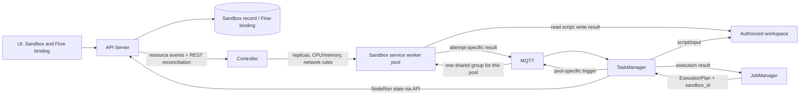

# Sandbox Pools

[System overview](../overview.md) · [Controller](controller.md) · [TaskManager](taskmanager.md) · [AgentFlow](../agent-flow.md)

**Status: fixed-pool architecture confirmed on 2026-11-14; runtime migration is not implemented.**
The definitions, fields and topics below are target contracts, not currently
available APIs or importable configuration. Existing JM-managed workers and
cluster-routed triggers are described under implementation differences below.

## Confirmed Model

- UI manages named Sandbox records, including CPU/memory and ingress/egress rules.
- Controller reconciles each enabled Sandbox into a persistent service worker pool.
- Every AgentFlow explicitly references a `sandbox_id`; multiple authorized Flows
  may reference the same pool. Application/session mode continues to select the
  JM/TM topology and does not select or own the Sandbox pool.
- TM dispatches a script only to that Sandbox's topic. Workers subscribe only to
  their configured namespace and Sandbox ID. A completed Run does not delete its pool.
- All workers and scripts within a pool share its resource and network boundary.
  A node MUST NOT override the pool's ingress/egress policy; another boundary
  requires another Sandbox definition.

## Resource and Persistence Contract

A Sandbox is a first-class namespaced resource, not a Flow's inline deployment
configuration. The proposed table name is `orh_sandbox`, following the existing
`orh_*` engine tables. PostgreSQL and SQLite stores MUST expose the same contract.
Only API Server accesses the table; Controller and workers use workload REST APIs.

| Fields | Meaning |
| --- | --- |
| `id`, `namespace_id`, `name`, `description` | Immutable ID; namespace-local unique name; display metadata |
| `image`, `allowed_runtimes` | Controlled worker image and supported script runtimes |
| `resources` | Per-worker CPU/memory requests and limits; not per-script guarantees |
| `replicas`, `slots_per_pod` | Configured pool capacity; maximum active scripts is replicas × slots |
| `network.ingress`, `network.egress` | Pool-wide default-deny/allow rules and required infrastructure access |
| `workspace_ref`, `credential_refs` | Authorized storage and secret references; never secret values |
| `enabled`, `generation`, `row_version` | Desired configuration, change tracking and optimistic concurrency |
| `observed_generation`, `conditions` | Controller-observed readiness/draining/error state, read-only to UI |
| audit fields | Creation/update times and principals, following existing resource conventions |

Field layout and physical JSON/column choices are proposed implementation details.
Pool identity, namespace ownership and policy boundary are the confirmed design.

The proposed management resource is `/api/v1/{namespace}/sandboxes`: list/create,
then get/update/delete by stable ID. UI shows configured and ready replicas,
active/available slots, policy readiness and reconciliation errors. Management
and Flow binding MUST use AuthGuard actions and namespace/resource SQL scope.
Controller reports observed status; a UI status edit cannot make a pool Ready.

Proposed Flow payload fragment (not accepted by the current strict decoder):

```yaml
sandbox_id: 9b91d028-7f3e-4a38-89e4-0b1aa42764ee
runtime_mode: application
resources:
  jobmanager: {cpu: "500m", memory: "512Mi"}
  taskmanager: {cpu: "1", memory: "1Gi"}
```

API validates the reference and authorization when saving and starting a Flow.
The selected Sandbox ID MUST be carried through the Run/ExecutionPlan to TM;
workers MUST validate it against the authoritative Run binding. A later Flow
edit MUST NOT silently redirect an already-created Run. This identity binding
does not define checkpoint/barrier/safepoint or recovery semantics.

## Control and Execution Flow



1. UI writes the Sandbox and Flow reference through API Server. Durable resource
   events prompt Controller reconciliation; periodic listing repairs missed events.
2. Controller owns the pool Deployment and its runtime configuration, network
   enforcement and workspace attachments. Reconcile ownership is keyed by
   `(namespace_id, sandbox_id)`, independently of Flow/Run and JM lifecycle.
3. Controller establishes the network boundary before admitting scripts. Ready
   requires ready workers, effective policy/capability probes and an active MQTT
   subscription. Deployment Ready alone is insufficient.
4. JM schedules a node normally; TM writes its script/input into the authorized
   attempt workspace, subscribes for its exact result, then publishes to the
   bound pool. TM does not create, scale or retarget the pool.
5. A pool worker validates namespace, Sandbox binding, node/attempt identity,
   runtime, deadline and workspace containment before consuming a slot.
6. Worker executes under the pool's fixed rules, writes the attempt's result,
   then publishes the correlated completion. TM persists NodeRun output through
   API Server and reports to JM. Components do not write business tables directly.

Workspace access must be independent of the originating runtime cluster. A
`workspace_ref` is an authorized storage reference, not proof that a path in TM's
filesystem exists in a pool worker. Shared RWX storage is valid only when both
sides can mount the authorized volume; Kubernetes requires a
[Pod's PVC to be in the same namespace](https://kubernetes.io/docs/concepts/storage/persistent-volumes/#claims-as-volumes).
Otherwise dispatch artifact references and transfer
script/input/output through the configured artifact backend. Never enqueue a
Pod-local path that the selected pool cannot read. Preserve Run/NodeRun-scoped
directories and original/result artifacts; prefixes alone are not access control.

A Kubernetes `Service` is not required for MQTT task dispatch. A separate
management endpoint may need a Service, but scripts are not submitted by direct
TM-to-Pod HTTP calls.

## Proposed MQTT Contract

```text
# TM publishes to one Sandbox ID (ID is the last path component):
flowgent/v1/{namespace_id}/sandbox/trigger/{sandbox_id}

# Every worker replica in that pool joins the SAME shared group:
$share/sandbox-{namespace_id}-{sandbox_id}/flowgent/v1/{namespace_id}/sandbox/trigger/{sandbox_id}

# Worker publishes; originating TM subscribes to its exact attempt:
flowgent/v1/{namespace_id}/sandbox/result/{sandbox_id}/{run_id}/{node_run_id}
```

The trigger and result envelopes MUST carry `sandbox_id`, `namespace_id`,
`flow_id`, `run_id`, `node_id`, `node_run_id`, `plan_id`, `attempt`, correlation ID,
TraceContext and deadline. NodeRun identifies an attempt; retries MUST NOT reuse
its result path. The trigger references script/input artifacts; the result
references output artifacts and includes exit/error diagnostics.

`runtime_cluster_id` MAY remain origin/trace metadata; it is no longer the
Sandbox consumption boundary. Pool workers MUST NOT subscribe to all Sandbox
IDs. Their shared group is per pool, not per replica or per Flow: separate
subscriber groups would each receive the work. Broker ACLs and worker-side
binding checks MUST enforce the boundary; a topic name alone is not authorization.

Shared subscriptions provide load distribution, not exactly-once execution.
Acceptance/deduplication and authoritative completion MUST be keyed by NodeRun
attempt; duplicates and stale results MUST NOT complete a different attempt.
The existing per-run result callback is insufficient for concurrent attempts.
Failure recovery/claim/fencing details remain separate runtime design work.

## Standard Network and Resource Isolation

- Kubernetes: Controller manages pool-labelled Deployments with resource
  requests/limits and ingress/egress NetworkPolicies enforced by a supporting CNI.
- Docker: the pool backend manages fixed worker containers with resource limits
  and isolated networks. Internal-only networks plus an explicit egress proxy
  provide the restricted-egress baseline. Docker does not natively implement
  arbitrary Kubernetes selector/port policies; unsupported rules MUST fail
  validation unless the backend provides equivalent enforcement.
- Domain allowlists belong at a controlled proxy/gateway. Setting proxy environment
  variables alone does not block direct connections. Standard NetworkPolicy rules
  are additive allows; an arbitrary ordered deny-rule API cannot be mapped blindly.
- DNS, MQTT, workload APIs and required storage are explicit infrastructure rules,
  not an automatic unrestricted exception. Custom seccomp user notification is
  not required for business network control; runtime-default syscall hardening
  remains an independent concern.

Pool resource limits cover the whole worker, including concurrent slots. A fixed
pool is a shared policy/trust boundary: directory naming is not filesystem or
tenant authorization. Workspaces and credentials require separate authorization;
untrusted tenants MUST NOT share a pool merely because network rules match.
Script environments MUST NOT inherit worker control-plane/broker credentials.

## Lifecycle and Decisions Still to Finalize

Capacity exhaustion queues work within a bounded deadline or fails explicitly;
it MUST NOT route to a different pool or a weaker execution backend. Disabling or
scaling down a pool stops new admission and drains admitted attempts. Deletion
MUST be blocked while referenced or while executions are admitted. Flow/Run GC
MUST NOT remove a shared Sandbox pool.

Changing network/resource configuration MUST NOT leave workers with different
policies competing on the same topic. Before implementing mutation, choose one
explicit policy: drain/reconfigure the entire pool before reopening admission,
or create a new Sandbox ID and rebind future Runs. The latter is the recommended
first implementation; it is not an approved hot-update/recovery contract.
This design does not add autoscaling or finalized checkpoint semantics.

## Implementation Differences and Migration

| Area | Current code | Fixed-pool target |
| --- | --- | --- |
| Persistence/UI | Global config and inline Flow/Node sandbox policy; no pool catalog | Namespaced Sandbox resource and Flow selector |
| Ownership | JM's ResourceManager creates/scales Sandbox by runtime cluster | Controller reconciles Sandbox independently; JM retains TM ownership |
| Trigger | Namespace + runtime-cluster + Flow/Run topic | Namespace + Sandbox-ID topic |
| Result | Per-run topic; callback accepts an unscoped TaskResult | Exact NodeRun attempt routing and validated envelope |
| Network | Child re-exec + seccomp notifier | Pool-wide standard platform networking |
| Local mode | Process-local/embedded behavior | Explicit configured container pool; no silent unrestricted fallback |

Existing source anchors: [model](../../../pkg/model/pkg/sandbox.go),
[TM executor](../../../pkg/core/pkg/engine/executor/sandbox.go),
[worker](../../../pkg/sandbox/pkg/sandboxmanager.go),
[topics](../../../pkg/messager/pkg/messager.go), and
[Flow model](../../../pkg/model/pkg/entities/flow.go).

Implementation must migrate the model/store/API/UI, Controller reconciliation,
Run/plan binding, topic helpers, worker admission/results and both deployment
backends together. Legacy `resources.sandbox`, `sandbox_policy` and node network
rules must be migrated to explicit approved pool bindings, never silently ignored
or converted into unrestricted networking. Workspace artifacts and existing
result/undo semantics must be retained with attempt-scoped access.

Acceptance must cover two distinct pools with different policies, same-pool
replica load sharing, concurrent results without cross-completion, node override
rejection, capacity/drain/delete behavior and real ingress/egress allow/deny
connectivity under both container backends. These are target criteria, not new
registered E2E scenarios or evidence of a completed runtime migration.

Platform references: [Kubernetes NetworkPolicy](https://kubernetes.io/docs/concepts/services-networking/network-policies/),
[Docker internal networks](https://docs.docker.com/reference/compose-file/networks/#internal),
[EMQX shared subscriptions](https://docs.emqx.com/en/emqx/latest/get-started/messaging/mqtt-shared-subscription.html).
