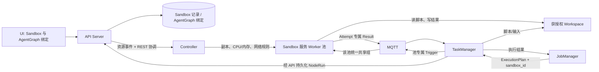

# Sandbox 固定池

[系统总览](../overview_ZH.md) · [Controller](controller_ZH.md) · [TaskManager](taskmanager_ZH.md) · [AgentGraph](../agent-graph_ZH.md)

**状态：2026-11-14 已确认固定池架构；运行时代码尚未迁移。**
下列字段、接口和 Topic 是目标契约，不是已经可用的 API 或可导入配置。
现有 JM 管理、按 runtime cluster 路由的实现差异见末节。

## 已确认模型

- UI 管理具名 Sandbox 记录，包含 CPU/内存和入站/出站网络规则。
- Controller 将每个启用的 Sandbox 协调为持久存在的服务 Worker 池。
- 每个 AgentGraph 显式引用 `sandbox_id`；多个获授权 AgentGraph 可以共用一个池。
  application/session 仍决定 JM/TM 拓扑，不决定也不拥有 Sandbox 池。
- TM 只向该 Sandbox 的 Topic 发送脚本任务；Worker 只订阅其配置的
  namespace 与 Sandbox ID。Run 结束不删除池。
- 同一池内所有 Worker 和脚本共享资源及网络边界。Node **MUST NOT** 覆盖
  池的入站/出站规则；不同边界使用另一个 Sandbox 定义。

## 资源与持久化契约

Sandbox 是独立的 Namespace 资源，不是 AgentGraph 内联的部署配置。建议物理表名
`orh_sandbox`，与现有 `orh_*` 引擎表一致。PostgreSQL/SQLite Store **MUST**
提供相同契约。只有 API Server 访问表；Controller/Worker 使用 workload REST API。

| 字段 | 含义 |
| --- | --- |
| `id`、`namespace_id`、`name`、`description` | 不可变 ID、Namespace 内唯一名称、展示信息 |
| `image`、`allowed_runtimes` | 受控 Worker 镜像和支持的脚本 Runtime |
| `resources` | 每个 Worker 的 CPU/内存 requests/limits；不是单脚本保证 |
| `replicas`、`slots_per_pod` | 配置的池容量；最大并发脚本数为 replicas × slots |
| `network.ingress`、`network.egress` | 池级默认拒绝/允许规则与必要基础设施访问 |
| `workspace_ref`、`credential_refs` | 获授权存储及凭据引用，不存机密值 |
| `enabled`、`generation`、`row_version` | 期望配置、变更标识与乐观并发控制 |
| `observed_generation`、`conditions` | Controller 观察的 Ready/Draining/Error，UI 只读 |
| 审计字段 | 沿用资源规范的创建/更新时间与操作主体 |

具体字段布局和 JSON/物理列选择属于建议实现；已确认的是池身份、Namespace
归属与策略边界。

建议管理资源为 `/api/v1/{namespace}/sandboxes`，支持列表/创建，再按稳定 ID
查询/更新/删除。UI 展示期望/就绪副本、活动/可用 Slot、策略就绪和协调错误。
管理及 AgentGraph 绑定 **MUST** 使用 AuthGuard Action 和 Namespace/Resource SQL Scope。
Controller 回写观察状态，UI 不能通过编辑状态把池声明为 Ready。

建议 AgentGraph 片段（当前严格解码器尚不接受）：

```yaml
sandbox_id: 9b91d028-7f3e-4a38-89e4-0b1aa42764ee
runtime_mode: application
resources:
  jobmanager: {cpu: "500m", memory: "512Mi"}
  taskmanager: {cpu: "1", memory: "1Gi"}
```

API 在保存和启动 AgentGraph 时校验引用与授权。Sandbox ID **MUST** 经 Run/
ExecutionPlan 传到 TM；Worker **MUST** 与权威 Run 绑定核对。之后修改 AgentGraph
**MUST NOT** 静默重定向已创建 Run。该身份绑定不定义 checkpoint/barrier/
safepoint 或恢复语义。

## 控制与执行流程



1. UI 经 API Server 保存 Sandbox 与 AgentGraph 引用；持久资源事件触发 Controller，
   周期列表协调补偿遗漏事件。
2. Controller 拥有池 Deployment、运行配置、网络执行规则和 Workspace 挂载。
   协调归属按 `(namespace_id, sandbox_id)`，独立于 AgentGraph/Run 和 JM 生命周期。
3. Controller 在接纳脚本前建立网络边界。Ready 必须包含 Worker 就绪、策略/
   能力探针生效和 MQTT 订阅成功；仅 Deployment Ready 不够。
4. JM 正常调度 Node；TM 将脚本/输入写入获授权 Attempt Workspace，先订阅
   精确结果再投递绑定池。TM 不创建、扩缩或重新选择池。
5. Worker 取得 Slot 前校验 Namespace、Sandbox 绑定、Node/Attempt 身份、
   Runtime、Deadline 和 Workspace 路径包含关系。
6. Worker 按固定池规则执行，写入 Attempt 结果，再发布关联完成事件。
   TM 经 API Server 持久化 NodeRun 输出并报告 JM；组件不直接写业务表。

Workspace 访问必须独立于来源 Runtime Cluster。`workspace_ref` 是获授权存储引用，
不代表 TM 文件系统路径在池 Worker 中存在。双方都能挂载获授权 Volume 时可用
共享 RWX；Kubernetes 要求 [Pod 与所用 PVC 在同一 Namespace](https://kubernetes.io/docs/concepts/storage/persistent-volumes/#claims-as-volumes)。否则消息传递 Artifact
引用，通过配置的 Artifact Backend 传输脚本/输入/输出。不得投递所选池读不到的
Pod 本地路径。保留 Run/NodeRun 范围目录及 Original/Result Artifact；路径前缀
本身不是访问控制。

MQTT 任务调度不要求 Kubernetes `Service`；独立管理端点可按需提供 Service，
但脚本不经 TM 直连 Pod HTTP 接口投递。

## 建议 MQTT 契约

```text
# TM 向唯一 Sandbox ID 发布，ID 是路径最后一段：
flowgent/v1/{namespace_id}/sandbox/trigger/{sandbox_id}

# 同池所有 Worker 副本使用同一个共享组：
$share/sandbox-{namespace_id}-{sandbox_id}/flowgent/v1/{namespace_id}/sandbox/trigger/{sandbox_id}

# Worker 发布，原 TM 精确订阅自己的 Attempt：
flowgent/v1/{namespace_id}/sandbox/result/{sandbox_id}/{graph_run_id}/{node_run_id}
```

Trigger/Result Envelope **MUST** 携带 `sandbox_id`、`namespace_id`、`agent_graph_id`、
`graph_run_id`、`node_instance_id`、`node_run_id`、`plan_id`、`attempt`、关联 ID、TraceContext
和 Deadline。NodeRun 表示一次 Attempt，重试 **MUST NOT** 重用结果路径。
Trigger 引用脚本/输入 Artifact；Result 引用输出 Artifact 并提供退出/错误诊断。

`runtime_cluster_id` 可作为来源/Trace 元数据保留，不再是 Sandbox 消费边界。
Worker **MUST NOT** 通配订阅所有 Sandbox ID。共享组按池建立，不按副本或
AgentGraph 建立，否则不同组会各自收到同一任务。Broker ACL 和 Worker 绑定校验
**MUST** 共同执行边界；Topic 名称本身不是授权。

共享订阅提供负载分摊，不保证脚本 exactly-once。接纳/去重与权威完成
**MUST** 按 NodeRun Attempt 关联，重复或过期结果 **MUST NOT** 完成其他 Attempt。
当前仅按 Run 的回调不足以处理并发 Attempt。故障恢复、Claim/Fencing 细节
仍属独立运行时设计。

## 标准网络与资源隔离

- Kubernetes：Controller 管理带池 Label 的 Deployment，配置资源 requests/
  limits，并由支持的 CNI 执行入站/出站 NetworkPolicy。
- Docker：池后端管理固定 Worker Container、资源限制和隔离网络。
  internal-only 网络配合显式出口代理作为受限出口基线。Docker 不原生具备任意
  Kubernetes Selector/Port 策略；后端不能等价执行的规则 **MUST** 拒绝配置。
- 域名白名单由受控代理/Gateway 执行；仅设置 Proxy 环境变量不能阻止直连。
  标准 NetworkPolicy 是叠加允许规则，不能盲目映射任意有序 Deny 规则。
- DNS、MQTT、Workload API 和所需存储必须显式授权，不是自动开放全部网络的
  例外。业务网络控制不再要求自定义 seccomp User Notification；RuntimeDefault
  系统调用加固是独立职责。

资源限制覆盖整个 Worker 及其并发 Slot。固定池是共享策略/信任边界：目录命名
不是文件系统或租户授权。Workspace 和凭据需要独立授权，不可信租户 **MUST NOT**
仅因网络规则相同而共池。脚本环境 **MUST NOT** 继承 Worker 控制面/Broker 凭据。

## 生命周期与待定事项

池满时在有界 Deadline 内排队或明确失败，**MUST NOT** 换投其他池或更弱后端。
禁用/缩容先停止新接纳，再排空已接纳 Attempt。有 AgentGraph 引用或已接纳执行时
**MUST** 阻止删除。AgentGraph/Run GC **MUST NOT** 删除共享 Sandbox 池。

网络/资源更新 **MUST NOT** 让不同策略 Worker 在同一 Topic 竞争任务。实现变更
前需选定：暂停接纳并排空整池后重配，或创建新 Sandbox ID、只重绑定未来 Run。
推荐首版用后者，但它不是已确认的热更新/恢复契约。本设计不引入自动扩缩容，
也不顺带定稿 Checkpoint 语义。

## 实现差异与迁移

| 范围 | 当前代码 | 固定池目标 |
| --- | --- | --- |
| 持久化/UI | 全局与 AgentGraph/Node 内联 Sandbox Policy，没有池目录 | Namespace Sandbox 资源与 AgentGraph 选择器 |
| 归属 | JM ResourceManager 按 Runtime Cluster 创建/扩缩 Sandbox | Controller 独立协调 Sandbox；JM 继续管理 TM |
| Trigger | Namespace + Runtime Cluster + AgentGraph/Run Topic | Namespace + Sandbox-ID Topic |
| Result | Run 级 Topic，回调直接接收未关联 NodeResult | 精确 NodeRun Attempt 路由与 Envelope 校验 |
| 网络 | 子进程 Re-exec + seccomp Notifier | 固定池统一标准平台网络 |
| 本地模式 | 本地进程/内嵌执行 | 显式配置的容器池，不静默降级为无限制执行 |

现有源码：[Model](../../../pkg/model/pkg/sandbox.go)、
[TM Executor](../../../pkg/core/pkg/engine/executor/sandbox.go)、
[Worker](../../../pkg/sandbox/pkg/sandboxmanager.go)、
[Topic](../../../pkg/messager/pkg/messager.go)、
[AgentGraph Model](../../../pkg/model/pkg/entities/graph.go)。

实施时须同步迁移 Model/Store/API/UI、Controller、Run/Plan 绑定、Topic Helper、
Worker 接纳/结果和两种部署后端。旧 `resources.sandbox`、`sandbox_policy` 和
Node 网络规则必须迁为明确获批准的池绑定，不能静默忽略或转成无限制网络。
Workspace Artifact 和现有结果/Undo 语义保留，并按 Attempt 授权访问。

验收应覆盖不同策略双池、同池副本负载分摊、并发结果不串线、拒绝 Node 覆盖、
容量/排空/删除，以及两后端真实入站/出站允许与拒绝。这些是目标验收条件，
不是新增已注册 E2E Scenario，也不是运行时已经迁移完成的证据。

平台参考：[Kubernetes NetworkPolicy](https://kubernetes.io/docs/concepts/services-networking/network-policies/)、
[Docker internal 网络](https://docs.docker.com/reference/compose-file/networks/#internal)、
[EMQX 共享订阅](https://docs.emqx.com/en/emqx/latest/get-started/messaging/mqtt-shared-subscription.html)。
