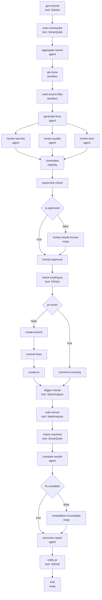

# Security Autonomy Fixer

[中文](README_ZH.md) · [AgentGraph architecture](../../docs/architecture/agent-graph.md)

Security Autonomy Fixer is a self-contained L2 AgentGraph application. It reads
the target GitHub commit and SonarQube findings, selects bounded source context,
generates and reviews a patch, passes deterministic and human gates, delivers
the change through GitHub, rechecks SonarQube, and posts a final report.

The application is configured under this directory and runs on the generic L1
Flowgent engine. Its nodes, edges, agents, integrations, and verification assets
belong here; the engine does not contain Security Fixer-specific scheduling
logic.

## Enterprise Authorization Preset

Local E2E runners quietly source `~/.secret.env` after the existing shell
profiles. Set `DEEPSEEK_API_KEY` there for `--e2e-llm-provider official`;
explicitly exported environment variables take precedence. GitHub Actions
receives the key from the repository's `DEEPSEEK_API_KEY` Secret.
Full semantic remediation acceptance selects `--e2e-llm-provider official`;
the default mock is intended for orchestration checks. CI selects the official
provider and retains the deterministic provider for architecture scenarios.

Run the production-shaped K8s deployment and real verification with one command:

```bash
HTTPS_PROXY=http://127.0.0.1:8800 make e2e-security-autonomy-fixer-with-helm
```

It verifies LDAP federated Principal discovery and the complete GitHub OAuth →
AuthGuard AuthN → Envoy JWT → AuthGuard AuthZ → Flowgent path. A successful
release is retained for manual use; `python3 runner.py --deployer k8s --access` keeps the
local tunnels open. Namespaces use the `e2e-flowgent-*` boundary while resources
inside them retain production-style names, with separate workload namespaces, a
dedicated Gateway controller name, and special ports. Flowgent and AuthGuard use the dedicated PostgreSQL schemas
`e2e_flowgent` and `e2e_flowgent_authguard`, so AuthGuard's adjacent default
E2E can run concurrently without sharing application state.

The retained human-acceptance origin is `https://flowgent.wl4g.com`. The E2E
Gateway and AuthGuard Application use that real host by default; override it
only with `FLOWGENT_E2E_APPLICATION_HOST`. Run the runner without
`--clean-after-run` to preserve the imported fixtures and execution evidence.
The Web remains available on diagnostic NodePort `31080`, but its API proxy uses
the protected Flowgent listener and anonymous requests fail closed. The retained
standalone acceptance login is stored (not printed) in the Kubernetes Secret
`acceptance-credentials` in `e2e-flowgent-authguard-system`; TOTP is deliberately disabled for this
password-only acceptance account.

The copy/paste-ready human review procedure is in
[`MANUAL_ACCEPTANCE.md`](MANUAL_ACCEPTANCE.md). After acceptance,
`python3 runner.py --deployer k8s --cleanup` first performs normal Helm and
namespace deletion, then applies bounded finalizer recovery only to owned E2E
objects and verifies that no release, namespace, Pod, PV, or cluster-scoped
E2E object remains.

AuthGuard's `standalone.totp.enabled` flag enables the TOTP enrollment/verifier
capability and publishes `standalone.totp=true` in application metadata, which
makes Hosted Login render the code input. It does not by itself require TOTP for
every password identity: server-side verification is required only after that
identity has a non-revoked enrolled TOTP credential. This acceptance profile
sets the flag to `false`, so the retained account is intentionally password-only.

The same runner also provides a functionally equivalent Docker Compose backend:

```bash
HTTPS_PROXY=http://127.0.0.1:8800 make e2e-security-autonomy-fixer-with-docker
```

Both backends execute the same ordered verifier matrix. K8s uses Helm,
isolated namespaces, and runtime Pods; Docker uses the
`e2e-flowgent-docker` Compose project and the standalone in-process runtime.
Both expose Flowgent/Web, PostgreSQL, MQTT, Jaeger, LDAP, GitHub OAuth mock,
AuthGuard AuthN/AuthZ/Web, Redis, and Envoy on isolated resources and ports.

The financial-enterprise preset provides Global Platform Security
Administrator, Security Automation Owner, Application Security Analyst,
Independent Model Risk Approver (MFA-conditioned), and Regulatory Auditor
roles. Regional LDAP groups receive tenant-scoped bindings with deny-by-default
semantics and separation of duties. Only LDAP discovery and GitHub OAuth are
enabled as identity features. A small isolated Redis cluster stores mandatory
one-time OAuth challenges; OIDC, Keycloak, SCIM, and custom discovery stay
disabled.

## Application Boundary

```text
security-autonomy-fixer/
├── runner.py
├── deploy/                       # horizontal service/component ownership
│   ├── flowgent/                 # official Docker links + config/ + docker-compose.yaml
│   └── <mock-xxx-service-or-case-dependency>/
│       ├── source/
│       ├── Dockerfile
│       ├── docker-compose.yaml
│       └── helm/
├── util/                         # generic helper entry points only
├── verifier/
│   ├── context.py                # shared context, lifecycle and application API
│   ├── infra/sNN_*.py
│   ├── core/sNN_*.py
│   ├── agentgraph/sNN_*.py
│   ├── otel/sNN_*.py
│   └── web/sNN_*.py
└── reports/                      # ignored evidence and rolling archives
```

Formal middleware is defined once in [`deploy/helm/flowgent`](../../deploy/helm/flowgent/) and [`deploy/docker/docker-compose.yaml`](../../deploy/docker/docker-compose.yaml). This case inherits those definitions; it does not own PostgreSQL, Redis, EMQX, Jaeger, Prometheus, Envoy or AuthGuard deployments. AuthGuard is the official Helm dependency, as in AgentVault; identity fixtures and verification remain case-owned.

Reusable runtime machinery lives in `tests/e2e_util/`; each case exposes the prescribed helper names through `util/`. `E2EImagesDefinitions` selects upstream or Aliyun addresses using `IN_GFW=true/false` (also accepting `IN_CN_GFW`). The three stdlib-only Python mocks reuse one official Python image by default. Their Dockerfiles support optional packaging; E2E builds no additional fixture images. The [confirmed review scope](../../docs/development/use-cases-review.md) records implemented checks and deferred work. UI and main-run telemetry are tied to persisted execution evidence; known runtime gaps fail explicitly.


| Resource  | Canonical file                                                              | Role                                                                                 |
| --------- | --------------------------------------------------------------------------- | ------------------------------------------------------------------------------------ |
| Main graph | [`security-autonomy-fixer.yaml`](deploy/flowgent/config/agent-graphs/security-autonomy-fixer.yaml) | 29-node, 33-edge remediation DAG                                                     |
| SubGraph   | [`sub-fix.yaml`](deploy/flowgent/config/agent-graphs/sub-fix.yaml)                                 | Three-node analyze → patch → validate graph; currently a separate reusable definition |
| Agents    | [`deploy/flowgent/config/agents/`](deploy/flowgent/config/agents/)                                      | Supervisor, detector, fixer, and three reviewers plus Git role                       |
| MCPs      | [`deploy/flowgent/config/mcps/`](deploy/flowgent/config/mcps/)                                          | GitHub delivery and SonarQube issue/scan access                                      |
| Envoy     | [`deploy/flowgent/config/envoy/envoy.yaml`](deploy/flowgent/config/envoy/envoy.yaml)                    | Declarative edge-proxy configuration, separate from deployment code                  |
| E2E       | [`runner.py`](runner.py)                                                  | Single entry for deployment, verification, manual access, and optional cleanup       |

The YAML manifest is the executable source of truth. This README explains its
intent and current behavior; when they differ, the manifest and observed E2E
evidence take precedence.

`--deployer k8s` is the canonical cluster mode. The former `kubernetes` value
is normalized as a compatibility alias. Image loading discovers the active
node runtime and imports into k3s' embedded containerd or the standard
containerd `k8s.io` namespace; local kind, minikube, and k3d contexts are also
recognized. Select a supported runtime explicitly with
`FLOWGENT_E2E_KUBERNETES_IMAGE_LOADER` (`auto`, `k3s`, `kind`, `minikube`,
`k3d`, or `containerd`) and, when needed, set
`FLOWGENT_E2E_KUBERNETES_CLUSTER`. An unsupported remote runtime fails closed
rather than importing an image to the wrong node store.

Agent execution defaults to the deterministic fixture with
`--e2e-llm-provider=mock`. Use `--e2e-llm-provider=official` to select the
imported DeepSeek provider; the runner requires the environment variable named
by its `api_key_env` before deploying Flowgent.

## AgentGraph Contract

The main graph has **29 nodes and 33 edges**. It uses eight generic AgentGraph
node types:

| Node type    | Count | Application use                                                          |
| ------------ | ----: | ------------------------------------------------------------------------ |
| `tool`       |    11 | GitHub, SonarQube and scanner MCP operations                                      |
| `agent`      |     7 | Finding normalization, patch generation, reviews, comparison, and report |
| `sandbox`    |     2 | Repository clone and bounded source read                     |
| `condition`  |     3 | Review approval, PR route, and completion route                          |
| `committee`  |     1 | Deterministic majority vote                                              |
| `supervisor` |     1 | Quota-bounded orchestration decision                                     |
| `human`      |     1 | Persisted approval before Git mutation                                   |
| `noop`       |     3 | Negative-condition forward fallbacks and terminal node                   |

External MCP integrations are GitHub and SonarQube. Sandbox scripts may also
reach the GitHub repository, the configured proxy endpoint, and SonarQube under
their explicit network allowlists.

## End-to-End DAG



All arrows are executable forward dependencies. Review disagreement is routed
through the persisted human gate, and incomplete re-scan results are captured
in the final report. Repeated remediation requires an explicit bounded subgraph
or run boundary until node reset semantics exist.

## Business Stages

|                        Stage | Nodes                                                                                                | Behavior and data boundary                                                                                                             |
| ---------------------------: | ---------------------------------------------------------------------------------------------------- | -------------------------------------------------------------------------------------------------------------------------------------- |
|          1. Commit discovery | `get-commit`                                                                                         | Reads `master` commit metadata from GitHub for `${vars.repo}`.                                                                         |
|         2. Finding discovery | `scan-sonarqube`                                                                                     | Calls SonarQube `GetIssuesSearch` for the repository project and `master` branch.                                                      |
|  3. Normalize and prioritize | `aggregate-issues`                                                                                   | Deduplicates by file/rule, orders severity, and selects at most ten findings.                                                          |
|    4. Bounded source context | `git-clone`, `read-source-files`                                                                     | Clones into the shared workspace, filters generated code, then selects at most one file, two issues, and 12,000 characters by default. |
|            5. Generate fixes | `generate-fixes`                                                                                     | Returns complete corrected file content plus structured patch metadata; it does not return diffs.                                      |
|         6. Multi-role review | `review-security`, `review-quality`, `review-arch`                                                   | Three agent roles independently judge security, quality, and architectural impact.                                                     |
|     7. Deterministic control | `committee`, `supervisor-check`, `is-approved`                                                       | Majority voting stays deterministic; supervisor actions are bounded by retry, node, injection, and action quotas.                      |
|                8. Human gate | `human-approval`                                                                                     | Persists a 24-hour approve/reject gate before any Git mutation.                                                                        |
| 9. Idempotent delivery route | `check-existing-pr`, `pr-exists`, `create-branch`, `commit-fixes`, `create-pr`, `commit-to-existing` | Chooses a new-PR or existing-PR path, then pushes complete file content.                                                               |
|             10. Verification | `trigger-rescan`, `wait-rescan`, `check-resolved`, `compare-results`, `fix-complete`                 | Submits analysis for the delivered commit, waits for its exact CE task, compares findings, and determines completion.               |
|                   11. Report | `summary-report`, `notify-pr`, `end`                                                                 | Produces structured summary data, posts it as a GitHub issue/PR comment, and terminates.                                               |

## Nodes and Edges

### Nodes

|     # | Node                                                               | Type         | Principal input or action                                   |
| ----: | ------------------------------------------------------------------ | ------------ | ----------------------------------------------------------- |
|     1 | `get-commit`                                                       | `tool`       | GitHub `get_commit`                                         |
|     2 | `scan-sonarqube`                                                   | `tool`       | SonarQube `GetIssuesSearch`                                 |
|     3 | `aggregate-issues`                                                 | `agent`      | Normalize `${scan-sonarqube}` with `issue-detector`         |
|     4 | `git-clone`                                                        | `sandbox`    | Clone repository with GitHub/proxy allowlist                |
|     5 | `read-source-files`                                                | `sandbox`    | Select bounded files and issues from workspace              |
|     6 | `generate-fixes`                                                   | `agent`      | Produce schema-constrained `files` and `patches`            |
|   7–9 | `review-security`, `review-quality`, `review-arch`                 | `agent`      | Independent structured patch votes                          |
|    10 | `committee`                                                        | `committee`  | Majority of the three review decisions                      |
|    11 | `supervisor-check`                                                 | `supervisor` | `continue`, `retry`, `inject`, or `abort` within quotas     |
|    12 | `is-approved`                                                      | `condition`  | `${committee.decision} == true`                             |
|    13 | `human-approval`                                                   | `human`      | 24-hour persisted gate                                      |
|    14 | `check-existing-pr`                                                | `tool`       | GitHub `list_pull_requests`                                 |
|    15 | `pr-exists`                                                        | `condition`  | Current manifest expression is literal `true`               |
| 16–19 | `create-branch`, `commit-fixes`, `create-pr`, `commit-to-existing` | `tool`       | GitHub delivery to `fix/flowgent_sec_auto_fix`              |
|    20 | `trigger-rescan`                                                   | `tool`       | Scanner `StartAnalysis` for the delivered commit                       |
|    21 | `wait-rescan`                                                      | `tool`       | Scanner `WaitAnalysis`, exact job/CE task, 1,200-second bound |
|    22 | `check-resolved`                                                   | `tool`       | SonarQube post-change `GetIssuesSearch`                     |
|    23 | `compare-results`                                                  | `agent`      | Classify complete/partial/none/max-iterations result        |
|    24 | `fix-complete`                                                     | `condition`  | Complete or max-iterations decision                         |
|    25 | `summary-report`                                                   | `agent`      | Structured final report and PR number                       |
|    26 | `notify-pr`                                                        | `tool`       | GitHub `add_issue_comment`                                  |
|    27 | `end`                                                              | `noop`       | Terminal                                                    |

### Conditional Edges

The other 27 edges are unconditional dependencies. These six edges carry an
explicit Boolean condition:

| From           | Condition | To                       | Current meaning                                                            |
| -------------- | --------: | ------------------------ | -------------------------------------------------------------------------- |
| `is-approved`  |    `true` | `human-approval`         | Approved review enters the persisted human gate directly                   |
| `is-approved`  |   `false` | `review-needs-human`     | Negative review enters the same gate through an auditable fallback node    |
| `pr-exists`    |   `false` | `create-branch`          | New branch and PR path                                                     |
| `pr-exists`    |    `true` | `commit-to-existing`     | Push to the fixed existing branch path                                     |
| `fix-complete` |    `true` | `summary-report`         | Complete remediation enters reporting directly                             |
| `fix-complete` |   `false` | `remediation-incomplete` | Incomplete remediation enters reporting through an auditable fallback node |

## Application Resources

| Resource          | Files                                                          | Role                                                                                                                      |
| ----------------- | -------------------------------------------------------------- | ------------------------------------------------------------------------------------------------------------------------- |
| Agent definitions | `deploy/flowgent/config/agents/01-supervisor.yaml` through `07-git-agent.yaml` | Model, instruction, schema, and role configuration                                                                        |
| LLM provider      | `deploy/flowgent/config/llmproviders/deepseek.yaml`                            | Model/provider connection used by the agents                                                                              |
| GitHub MCP        | `deploy/flowgent/config/mcps/github.yaml`                                      | Commit lookup, PR lookup, branch creation, file push, PR creation, and comment delivery                                   |
| SonarQube MCP     | `deploy/flowgent/config/mcps/sonarqube.yaml`                                   | Finding discovery, export/recheck, and post-change comparison input                                                       |
| Notifiers         | `deploy/flowgent/config/notifiers/email.yaml`, `webhook.yaml`                  | Importable notification-channel definitions; the main 29-node DAG currently terminates through a GitHub comment tool node |

Runtime credentials MUST enter through the configured deployment Secret or
environment contract. They MUST NOT be embedded in graph, agent, MCP, or README
files.

## Current Limits

1. `pr-exists.expression` is the literal `true`, so the current manifest always
   selects `commit-to-existing`. A reusable version MUST derive this condition
   from `check-existing-pr` output.
2. Review disagreement still enters the human gate, and incomplete re-scan
   results still enter `summary-report`; this is the safe one-shot fallback
   until repeated-node reset semantics exist.
3. `${vars.iteration}` starts at `0` and this graph does not mutate it. The
   `max_iterations` comparison does not by itself implement repeated runs.
4. Review siblings are logically independent but are currently dispatched
   sequentially because JobManager blocks on each `Schedule()`.
5. Re-analysis uses the E2E scanner CI adapter. It requires the actual delivery
   SHA, a new successful CE task and an analysis revision matching that SHA.
   Deployments outside this fixture need an equivalent CI adapter contract.
6. The `sub-fix` definition is not referenced by a node in the main manifest;
   it is a separate reusable graph, not part of the 29-node execution path.

Until repeated-node reset semantics exist, an executable multi-pass design
MUST use a bounded node retry or an explicit subgraph/run boundary.

## Verification and Operations

Run the complete real-cluster gate from the repository root:

```bash
HTTPS_PROXY=http://127.0.0.1:8800 make e2e-security-autonomy-fixer-with-helm
```

The unified runner builds the Flowgent images, deploys either the root Helm
chart or the equivalent Compose topology with AuthGuard/Envoy, imports
`config`, and verifies
infrastructure, LDAP discovery, GitHub OAuth, edge allow/deny policy, telemetry,
API Server, Notifier, Controller, MQTT, A2A, remediation, PR delivery, knowledge,
the shared workspace, and a real Chromium console lifecycle (create, execute,
update, and delete a sandbox AgentGraph through the shipped Web UI). Install the E2E
requirements and Chromium before running the browser scenario outside CI:

```bash
python3 -m venv use-cases/security-autonomy-fixer/.venv
use-cases/security-autonomy-fixer/.venv/bin/python -m pip install -r use-cases/security-autonomy-fixer/requirements.txt
use-cases/security-autonomy-fixer/.venv/bin/python -m playwright install chromium
```

Useful focused modes are:

```bash
E2E_ARGS="--scenario 14 --skip-sonarqube --skip-build --skip-import --skip-deploy" make e2e-security-autonomy-fixer-with-helm
E2E_ARGS="--scenario 41 --skip-sonarqube --skip-build --skip-import --skip-deploy" make e2e-security-autonomy-fixer-with-helm
python3 use-cases/security-autonomy-fixer/runner.py --deployer k8s --access
E2E_ARGS="--clean-after-run" make e2e-security-autonomy-fixer-with-helm
make e2e-security-autonomy-fixer-with-docker
python3 use-cases/security-autonomy-fixer/runner.py --deployer docker cleanup
```

Cleanup is opt-in: `--clean-after-run` defaults to false. A successful ordinary
run retains the selected backend for manual evaluation. Cleanup removes only
the isolated `e2e-flowgent-*` Helm namespaces or the
`e2e-flowgent-docker` Compose project and its named volumes.

Generated data is organized as `reports/round-XX/`: verifier Markdown sits
at the round root and machine evidence/screenshots live under
`evidence/<scenario>/`. Transient cross-verifier state remains hidden under
`reports/.state/`. These artifacts are execution evidence, not design sources;
they MUST NOT replace assertions against the manifest, REST state, MQTT routing,
PostgreSQL, Kubernetes resources, or external-system outcomes.

## Expected Behavior

1. **Given** the main manifest, **when** it is loaded, **then** it MUST contain
   29 uniquely named nodes and 33 valid edges with the node-type counts stated
   above.
2. **Given** SonarQube findings, **when** source context is selected, **then**
   generated-code paths SHOULD be excluded and the configured file, issue, and
   character bounds MUST be respected.
3. **Given** generated fixes, **when** reviews complete, **then** all three votes
   MUST feed the deterministic committee before supervisor or human approval.
4. **Given** any Git mutation, **when** it becomes eligible, **then** committee,
   supervisor, condition, and persisted human gates MUST already have passed.
5. **Given** either delivery branch, **when** code is pushed, **then** the graph
   MUST converge on SonarQube recheck, comparison, report, and GitHub comment.
6. **Given** a negative review or incomplete re-scan, **when** one-shot runtime
   execution continues, **then** it MUST reach the human gate or final report
   without attempting to rerun an already-completed node.
7. **Given** application review or E2E verification, **when** observed behavior
   conflicts with this explanation, **then** the executable manifest and
   observed runtime evidence MUST be treated as authoritative.

The real-analysis fixture lives in `deploy/sonar-scanner-service/`. It reuses the pinned
SonarSource scanner image, downloads the exact GitHub commit archive, and runs
actual analysis. Scenario 31 records the initial CE task, analysis revision and
source findings. Re-analysis requires the delivered commit and a different,
successful CE task; selected finding IDs are checked directly after analysis.

The Java source analysis currently runs without compiling dependency bytecode;
its results do not establish complete bytecode/type-resolution coverage.

The additional vNext scenarios are `61` (Static SubGraph execution,
Adaptive Supervisor expansion, Seal, graph CAS and decision replay) and `62`
(10 persistent claims, duplicate completion, transactional result Outbox and
late Attempt rejection). Run with the deterministic LLM fixture. These are
protocol/orchestration checks; the unimplemented recovery boundaries are listed
in [the AgentGraph implementation boundary](../../docs/architecture/agent-graph.md#agentgraph-domain-and-durable-recovery).

Scenario `63` verifies a SIGKILL during a Sandbox mutation, baseline restoration
before a new NodeRun Attempt, verified final WorkspaceSnapshot, immutable
GraphRun snapshot, and consistent GraphCheckpoint recovery. Namespace/graph/run
REST and MQTT names use the canonical AgentGraph domain; old aliases are removed.
